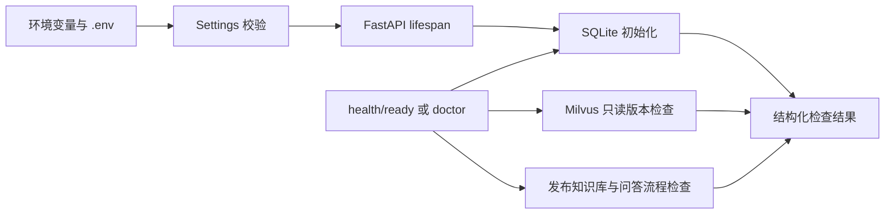

# P0 学习与验收

## 这阶段解决了什么

P0 先把“项目能独立启动、依赖能连接、故障能区分”做可靠。它为后面的 RAG 留出清楚的入口，还没有实现文档问答。

## 读代码的顺序

### 1. settings.py：配置是输入，也要校验

- 路径相对项目定位，避免从不同工作目录启动时误写出另一份数据库。
- `.env` 只记录本机配置，不提交 Git；示例文件可提交。
- Milvus URL 不接受内嵌账号密码；令牌使用 SecretStr，诊断不输出原始 SDK 异常参数。
- 月预算字段不允许超过已接受的 50 元。完整费用预留/记账在 API 阶段实现，不能把一个配置校验说成已经实现完整账单控制。

### 2. storage/sqlite.py：原文元数据的基础

- Engine 管理数据库连接，Session 负责一段读写工作。
- `create_all` 只创建缺少的表，不删除已有数据；单元测试已经检查重新初始化后记录仍在。
- `KnowledgeBase` 只保存当前发布代的指针；`IndexGeneration` 保存代状态。
- 即使有 active_generation_id，也要确认它属于同一个知识库且状态为 ready，不能把构建中或其他库的记录当成已发布。
- P0 没有创建一个假的“已发布知识库”来把界面变绿。

### 3. diagnostics.py：按事实报告，而不是一律返回成功

- `probe_milvus` 只连接并确认服务版本，不创建、清空集合。
- `milvus_smoke` 是用户显式选择的写测试：随机命名自己的临时集合，真实写入 dense/sparse，检索与删除，最后清理自身集合。
- 这两个模型无关的测试不能证明语义检索效果；测试用的 2 维向量只是检查数据库行为。
- `model_smoke` 使用真实 bge-small 产生 512 维向量，但只处理三条短句，不代表完整数据集性能。

### 4. main.py 与 cli.py：入口不同，检查逻辑共享

- HTTP 和 CLI 都复用相同的存储及诊断函数，不各自维护一套判断规则。
- lifespan 在启动时准备数据库，在关闭时释放连接；import 模块不会加载模型或连接 Milvus。
- `/health/live` 不查数据库，只证明应用进程能响应。
- `/health/ready` 查询依赖与知识库状态。P0 仍缺知识库与生成流程，所以返回 503 是正确结果。
- doctor 的 `foundation_ready=true` 表示基础依赖正常，不代表完整 RAG ready；加 `--require-ready` 时它会明确返回非零。

## 可以自己验证的三件事

1. 打开 `http://127.0.0.1:8000/docs`，执行 live 与 ready，观察 200 和 503 的区别。
2. 运行 `uv run --no-sync python -m debug_rag.cli doctor`，找到 SQLite/Milvus 的成功项，以及知识库未初始化的项。
3. 阅读 `tests/unit/test_storage.py`：理解为什么“重新创建数据库连接”不等于“清空数据库”，以及发布指针为什么要检查归属和状态。

这三项是理解入口，不要求你为了继续阶段工作逐题交作业。测试的实际版本、输出和限制见 [progress.md](progress.md)。

## 和后续 RAG 的连接

P1 将把模拟 Markdown/TXT 解析成可定位的原文与片段，补上文档 revision 和索引 generation。之后逐步接入 Embedding、召回、重排与模型 API，只有这些链路真实就绪后，ready 才应该返回成功。

Docker 当前只运行 Milvus。API 仍运行在宿主机，连接 `127.0.0.1:19530`；应用容器化之后，才改用 Compose 服务名通信。这个变化体现的是网络位置，不是更换数据库。
