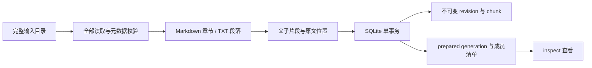

# P1：资料如何成为可追溯的检索片段

P1 已完成文档准备链路。输入是本地模拟资料，输出是 SQLite 中的原文、版本、父子片段和 `prepared` 清单。本阶段没有向量化、检索、重排或问答，不产生模型费用。

## 先运行一遍

在 `debug-rag` 项目目录运行：

```powershell
uv run --no-sync python -m debug_rag.cli ingest --kb demo-debug --source fixtures/documents --profile light
uv run --no-sync python -m debug_rag.cli inspect --kb demo-debug
uv run --no-sync python -m debug_rag.cli inspect --kb demo-debug --chunks
```

当前资料应得到 8 文档、33 父片段、34 子片段。首次导入创建数据；再次原样导入应复用同一个 generation，并返回 `created_revisions=0`、`created_chunks=0`。准备命令不依赖 Milvus 在线，不需要 API Key。

最后一条会输出原文，适合本地查看。若要保存一份审阅结果：

```powershell
uv run --no-sync python -m debug_rag.cli inspect --kb demo-debug --chunks | Set-Content -Encoding utf8 runtime/P1-inspect.json
```

实际交付时已保存上述文件，属于忽略 Git 的本机运行数据。将来换成业务资料后，也不要把检查输出直接发布到公开仓库。

## 资料里有什么

| 文件 | 主要用途 | 状态 |
|---|---|---|
| 01-demo-overview.md | 入口、范围、何时先澄清展示位置 | delivered |
| 02-camera-state.md | 状态字段、开发接入、前置条件 | delivered |
| 03-camera-card.md | 调试页卡片的步骤与验证 | delivered |
| 04-overlay.md | 应用内悬浮层、生命周期、组合展示 | delivered |
| 05-file-export.md | 脱敏、保存、取消、失败、清理 | delivered |
| 06-validation.md | 如何记录验证证据与连续问答场景 | delivered |
| 07-future-system-overlay.md | 系统级悬浮窗仅为规划，不能冒充现有能力 | planned |
| 08-lifecycle.txt | 用 TXT 演示三类功能的清理规则 | delivered |

这些资料独立编写，文件中已标明模拟身份。它们没有真实公司架构、接口名、源码或客户数据，不代表已经实现 Android 功能。`delivered` 也只是模拟业务快照的能力标签。当前并没有根据这些资料实际运行 Android 验证。

## 一份文档的约定

Markdown 必须以 YAML frontmatter 开头：

```yaml
---
source_key: demo-camera-state
title: 相机状态的来源与展示接入
app_snapshot: demo-v1
data_kind: simulated
feature_status: delivered
updated_at: 2026-10-25
external_processing_allowed: true
---
```

后面才是正文。TXT 不把这段元数据混进正文，而是使用同名文件，例如 `08-lifecycle.txt` 配 `08-lifecycle.meta.json`；JSON 内容为相同字段。两种格式都要求 UTF-8，可以有 BOM 和 Windows CRLF。暂不接 PDF、DOCX、图片或 OCR。

| 字段 | 作用与约束 |
|---|---|
| source_key | 同一库内的逻辑身份；小写字母/数字开头，仅允许小写字母、数字、点、下划线、连字符，最长 100 字符 |
| title | 显示名称，非空，最长 200 字符 |
| app_snapshot | 业务快照标签，不等于索引 generation；只允许字母、数字、点、下划线、连字符 |
| data_kind | simulated 或 business；P1 只导入了自编 simulated 资料 |
| feature_status | delivered、developing、planned；每篇一个状态，混合内容应先拆文档 |
| updated_at | 真实有效的 YYYY-MM-DD 日期，不接受时间戳或任意字符串 |
| external_processing_allowed | 必须是布尔值，不能写成字符串 "false"；本字段不自动授予业务资料使用许可 |

所有字段必填，未知字段、重复键、YAML 别名和自定义对象标签会被拒绝。单文件最大 2 MiB（包括 TXT 元数据）；正文不能为空。LF/CRLF 均保留，单独 CR 不支持；NUL 字符拒绝。目录只发现 `.md`/`.txt`，忽略其他扩展名，TXT 的 JSON 会作为 sidecar 读取。读取文件不能通过链接越过所选目录边界。

同一个输入批次不能混用 app_snapshot/data_kind。同一库后续导入也保持这两个标签一致；要导入不同快照或业务资料，应使用另一个 `--kb`。这为当前单快照演示提供隔离；将来若需要在同一库切换业务快照，要先实现明确的迁移规则。

## 从文件到数据库



先读取、校验和解析全部文件，成功后才进入写事务。任何一个文件不合法就拒绝整批；写入阶段发生异常也回滚整批。已有 prepared 和已发布指针都不受失败影响。当前单人本机使用，按顺序运行导入，不把并发导入作为已支持能力。

`--source` 表示本次完整输入集合。推荐总是传一个整理好的目录。若只传一个文件，这一代只包含那个文件，不会自动加入以前导入的其他文档。减少输入文件会改变新清单，但历史原文仍保留；物理清理与发布删除流程留待后续阶段。

## 为什么有多种 ID

| 对象 | 代表什么 | 何时变化 |
|---|---|---|
| document_id | 知识库 + source_key 对应的逻辑文档 | 换 source_key/库时是不同文档；仅改文件名不变 |
| revision_id | 原文、格式与元数据的不可变版本 | 内容、格式或有效元数据变更；再次遇到旧内容可以复用旧 revision |
| chunk_id | 指定 revision、切片配置与顺序的片段 | revision 或配置变化 |
| generation_id | 一批 revision 在某个解析/切片配置下的准备快照 | 成员或配置变化；相同输入复用已有 prepared generation |

`source_path_at_revision_creation` 是版本创建时的来源路径。文件重命名时不会修改旧版本；查看原文依赖保存的 revision，而不是要求旧路径仍然存在。

切片配置包含算法版本和实际 `markdown-it-py` 版本。因此升级解析器也会触发新的准备配置，避免用旧片段假装已按新解析器构建。纯文件名、元数据空白格式的变化不构成新内容版本；原文字节内容对应的换行变化会构成新版本。

SQLite 表的职责：

- `knowledge_bases` / `index_generations`：保留 P0 原表；只有 ready 的 active generation 才可被认定发布。
- `documents`：稳定身份；`document_revisions`：原文、元数据、格式与来源。
- `source_chunks`：父子片段、位置、章节、配置；`generation_documents`：某一代具体使用哪些 revision。
- `prepared_heads`：本库最后一次成功准备的清单。即使恢复并复用较早一代，默认 inspect 也能看到这次选择的版本。

P1 新增表，不删除原表，不依赖 `create_all()` 自动修改已有列。业务快照/资料类别当前放在 generation manifest 中校验；后续涉及改列时必须做迁移。

## 怎么检查一段原文

1. 执行 `inspect --kb demo-debug --chunks`，找到 `metadata.source_key=demo-camera-state` 的文档。
2. 找到 `section_path` 为“相机状态展示接入 / 接入步骤”的父片段。该章节较长，子片段会有相同的 `parent_chunk_id`。
3. 对照文件，确认 `text` 与 `start_line` 到 `end_line` 的原文一致。
4. 若切在行中，行号只表示所在行；精确内容由 `[start_char, end_char)` 决定。

字符位置是保存的整份原文中的 **Python Unicode 字符下标**，从 0 开始、结束不包含；不是字节偏移或 JavaScript UTF-16 下标。行号从 1 开始、结束包含，计入 Markdown 的元数据头。BOM/CRLF 原样保存，不做换行替换、自动摘要或补写代码围栏。

Markdown 的章节来自真正的标题 token；代码块里的 `#` 不会变成标题，TXT 中的 `#` 也只是普通文字。优先保留段落、列表、表格和代码块；超过上限的块会继续切，设置 `continuation=true`，表明它可能不是独立完整结构。渲染或组装证据时需要考虑这一点。

当前父片段最多 1600、子片段最多 600 字符，没有重叠。短章节可能父子文本相同，这是结构正常的结果。字符上限只控制初切，P2 调模型前仍需检查各自 token 限制。片段继承的是所属 revision 的版本、资料类别、功能状态和外发标志；以后检索时仍必须落实过滤，P1 没有宣称已完成检索权限控制。

## 三个可复现验收

**重复导入**：连续执行两次相同 ingest。第二次应该复用 generation、新增数据为 0，不能只看“没有报错”。

**内容修订**：建议把 `fixtures/documents` 复制到 `runtime/p1-practice` 后，在练习副本改一段文字，使用独立库导入，避免污染标准演示资料：

```powershell
# 仅在目标目录不存在时执行复制；存在时直接使用已有练习目录。
Copy-Item -LiteralPath fixtures/documents -Destination runtime/p1-practice -Recurse
uv run --no-sync python -m debug_rag.cli ingest --kb p1-practice --source runtime/p1-practice
# 编辑练习副本中一篇文档，保持 source_key 不变，再执行同一条 ingest。
```

预期同一 document 新增一个 revision 和 generation；旧 generation 可通过 `inspect --kb p1-practice --generation <旧ID> --chunks` 查看，文字仍为旧版本。换切片参数则保留 revision，产生新切片配置与 generation。

**失败隔离**：在练习副本加一份缺少元数据的 Markdown 后导入。应返回 `document_preparation_failed`，列出文件和 `missing_frontmatter`，退出码 2；再次 inspect 应仍是上一份成功清单。删掉练习用错误文件后才能再次导入整批。

常见错误码：`invalid_metadata`（看 location 字段）、`invalid_metadata_syntax`（格式/重复键）、`file_unreadable`（包括缺失 TXT sidecar）、`invalid_utf8`、`empty_body`、`duplicate_source_key`、`mixed_snapshot_or_data_kind`、`kb_snapshot_or_data_kind_conflict`、`source_outside_root`。不会把异常中的元数据值或密钥直接打印出来。`--publish` 返回 `publishing_unavailable_in_p1`，且不会创建导入数据。

## 读代码的顺序

1. `ingestion/documents.py`：文件 → 严格 Metadata + 未改写原文 + 正文起点。
2. `ingestion/chunking.py`：原文 → Markdown 行映射/段落 → 精确区间的父子 Chunk。
3. `storage/sqlite.py`：这些数据如何落表、通过哪些身份关联。
4. `ingestion/service.py`：全批校验、幂等、事务、准备清单与检查输出。
5. `cli.py`：把本地命令接到上述流程，并返回明确退出码。

Markdown token 与行号 map 的接口参考 [markdown-it-py 官方文档](https://markdown-it-py.readthedocs.io/en/latest/using.html)。依赖锁定的实际版本为 4.2.0；没有通过渲染 HTML 来重建原文。

## 验证结果与下一步

46 项单元测试通过，覆盖 P0 回归、元数据失败、精确位置、超长文本、幂等、修订、配置换代、跨库隔离、事务失败与未发布状态。本机实际导入与重复导入也已执行，结果见 `docs/progress.md`。当前仅是流程和数据正确性证据，不是召回率或业务正确率。

P2 才把子片段送入本地 Embedding，建立检索索引，接生成与引用，并在真实检索校验后发布。重排、Query 改写、混合检索按已确认路线逐步引入。P1 不会为了展示技术点提前调用付费模型，也不把准备成功写成问答已可用。
