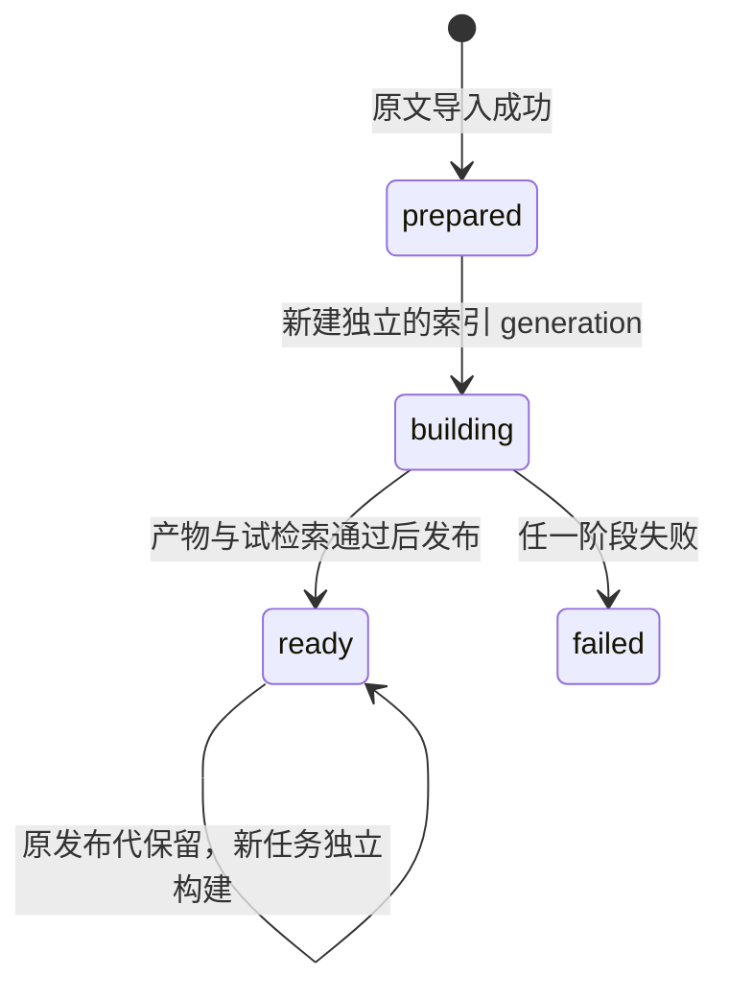

# P2 原理与代码导读：从一份文档走到一条回答

核对日期：2026-11-01。配套总览：[项目全景与学习路线](项目全景与学习路线.md)。基础概念见 [原文、向量与 BM25 的数据关系](原文向量与BM25的数据关系.md)。

本文讲的是当前实现，明确标记待验证部分。先用“文件导出取消后需要清理什么？”贯穿整条链路，再学习失败和边界。文中的简化结构示例不是一次已经执行成功的真实模型回答。

## 1. 三种模型/算法职责，先分清

| 名称 | 接收什么 | 输出什么 | 当前项目状态 |
|---|---|---|---|
| Embedding | 单段文档或问题 | 固定维度的数值向量 | 本地 bge-small 已真实编码 |
| BM25 | 已分词语料与查询词 | 词面相关性分数 | rank-bm25 已接入 |
| RRF | 多路候选的排名 | 合并后的候选排名 | 普通 Python 已实现 |
| Reranker | 问题与候选文档对 | 更细的相关性排序 | 百炼适配与可选链路已接入，默认关闭；真实 API 待联调 |
| 生成模型 | 系统要求、问题、证据 | 结构化答案文本 | DeepSeek 适配已写，真实调用待验证 |

Embedding 不负责写答案；RRF 不理解问题和段落语义；生成模型不能替代可靠的资料检索。当前没有训练或微调任何模型。

## 2. 从文件开始：知识不是存进向量就结束了

先打开 `fixtures/documents/05-file-export.md`。它规定了模拟文件导出的输入、脱敏、取消、失败和清理行为。

关键元数据有：

```yaml
source_key: demo-file-export
app_snapshot: demo-v1
data_kind: simulated
feature_status: delivered
external_processing_allowed: true
```

这里的 delivered 是模拟版本的状态，不是公司上线证明；external_processing_allowed 是资料外发标志，也不是取得公司资料使用许可的替代品。

读代码：[documents.py](../src/debug_rag/ingestion/documents.py) 的 `Metadata`、`load_document()` 和 `load_source()`。

这一层做四件事：

1. 限定本地 Markdown/TXT 与 UTF-8 编码；TXT 从同名 `.meta.json` 读取元数据。
2. 校验必填字段、枚举、布尔值和日期；拒绝未知/重复键、空正文等错误。
3. 保留原始文本、BOM 和 LF/CRLF；不让后续模型改写结果替代原文。
4. 全批检查重复 source_key、业务快照与资料类别是否混用。

对于当前演示，知识依据应来自文件内容。例如文件明确描述了取消后的临时副本清理，系统才可以据此回答；不能凭常识补出公司内部导出接口名。

## 3. 切片：把原文变成能定位的区间

读代码：[chunking.py](../src/debug_rag/ingestion/chunking.py) 的 `ChunkConfig`、`chunk_document()` 和 `partition()`。

当前算法按 Markdown token 的行映射识别标题、段落、列表、表格、代码块；TXT 按普通段落处理。然后在章节内形成父片段和更小的子片段。

默认上限：父片段 1600 字符，子片段 600 字符。它们是起始参数，不是已经通过业务评测得到的最优值。短章节可能父子文本完全相同。

每个片段保存：

```text
chunk_id / revision_id
parent_chunk_id
section_path
text
start_char / end_char
start_line / end_line
continuation
```

最重要的不变量是：

```text
chunk.text == revision.raw_text[chunk.start_char : chunk.end_char]
```

字符位置从 0 开始，结束不包含；行号从 1 开始，结束包含，并计入 Markdown 元数据头。字符位置是 Python Unicode 下标，不是文件字节偏移，也不是 Kotlin/JavaScript UTF-16 下标。

代码块中的 `#` 不会被识别成章节标题。超长块无法完整放下时会继续切，并标记 continuation，而不是在原文中人为补一段代码围栏。大块是否适合独立展示，要在使用片段时继续判断。

**2026-11-01 已接入 small-to-big。** 检索仍命中子片段，生成上下文阶段按预算扩展到同版父片段。默认 `RAG_PARENT_EXPANSION_ENABLED=true`；父段超限则回退完整子片段，同一父段只加入一次，并保留触发命中的子片段 ID。代码与模拟依赖测试已完成，真实业务收益尚未评测。

## 4. 四种身份与一个业务版本

读代码：[sqlite.py](../src/debug_rag/storage/sqlite.py)、[ingestion/service.py](../src/debug_rag/ingestion/service.py)。

| 字段 | 回答的问题 | 示例含义 |
|---|---|---|
| source_key | 这是哪份逻辑资料？ | demo-file-export |
| document_id | 这份资料在这个库里的稳定数据库身份？ | 改文件名仍可保留身份 |
| revision_id | 这是哪一版原文与元数据？ | 改正文或有效元数据会形成新版本 |
| generation_id | 本次检索使用哪份完整资料/配置快照？ | 固定一批 revision 与索引产物 |
| app_snapshot | 文档适用哪个业务版本？ | demo-v1；不同于索引构建次数 |

假设修改了一句导出流程，source_key 和 document_id 可以不变，revision 要变化。若只改变切片配置或模型配置，业务版本可能仍是 demo-v1，但检索索引需要换代。

导入时先解析全批输入，再用 SQLite 事务保存资料。`prepared_heads` 记录本库最后一次成功准备的清单；`knowledge_bases.active_generation_id` 是实际查询所用的已发布指针。**默认 inspect 读准备指针，查询读发布指针。**

原样重复 ingest 会复用版本和 prepared 清单；当前 build-index 每次成功会生成新的索引 generation，并不会自动复用已有完整索引。

## 5. 为什么同时需要 SQLite、JSON 和 Milvus

| 存储 | 当前保存的内容 | 查询时的职责 |
|---|---|---|
| SQLite | 原文、元数据、身份关系、版本、父子片段、generation 与费用台账 | 读取权威原文，验证版本与引用关系 |
| `runtime/indexes/<generation>/lexical.json` | 分词语料 corpus、向量窗口映射 windows | 重建 BM25 评分对象，映射向量命中回 chunk |
| Milvus | 稠密向量、窗口主键及相关标量字段 | 相似度检索与范围过滤 |

Milvus 当前没有保存完整原文。相似向量找出来后，仍需根据 ID 回 SQLite 拿原文和元数据。不能把“找到一个向量”直接当成“已有完整且适用的答案”。

`lexical.json` 不是反序列化的 Python pickle 模型。当前每次搜索从分词语料构造 BM25Okapi 对象，适合演示规模；缓存与大规模性能没有在这里完成优化。

## 6. Embedding：512 维到底是什么

读代码：[embedding.py](../src/debug_rag/retrieval/embedding.py) 的 `_load()`、`windows()`、`encode()`。

主链路使用本地 `AutoTokenizer` 和 `AutoModel`，CPU 上运行，读取模型本地文件，关闭自动下载与远程自定义代码。加载后使用 eval 和 inference_mode，不计算训练梯度。

对一批输入，模型输出每个 token 的隐藏状态。代码取：

```python
output = self._model(**batch).last_hidden_state[:, 0]
normalized = torch.nn.functional.normalize(output, p=2, dim=1)
```

这里 `[:, 0]` 是取每条输入第一个 token 的表示，作为 CLS pooling；随后把向量长度归一化。维度 512 表示每条输入用 512 个数表示，与“最多 512 tokens 的输入长度”是两个不同概念，只是在这个模型上数值碰巧一样。

向量的每一维不是人为定义的“相机程度”“文件程度”。语义关系来自模型训练形成的整体表示；你不需要给它手工安排 512 个业务字段。

文档直接编码原文；查询会加上当前配置的检索前缀。模型身份记录本地文件摘要、维度、pooling、归一化、前缀、相关库版本。查询时会与建库身份比较，避免偷偷换成另一套向量空间。这里的文件摘要是本地复现依据，不是远程官方权重签名认证。

### 6.1 为什么 P1 切过片，P2 还要检查 token

600 个字符不一定是 600 个 token，不同 tokenizer 的结果也不同。P2 会使用本地模型 tokenizer 检查输入，并把超长子片段划成向量窗口。

窗口保存相对于子片段的 start/end：

```text
原文绝对起点 = chunk.start_char + window.start
原文绝对终点 = chunk.start_char + window.end
```

一个子片段可能产生多个向量窗口，所以向量记录数不一定等于子片段数。当前这份资料实际为 34 个子片段、34 个窗口；长文本窗口算法另外有单元测试覆盖。

查询命中窗口后，先归并到原文子片段；当前送给生成器的是选中的完整子片段，不是改写后的向量窗口文本，也不是整份父文档。

## 7. Milvus：为什么当前使用 FLAT + COSINE

读代码：[milvus.py](../src/debug_rag/storage/milvus.py)。

当前数据很小，用 FLAT 的目标是建立容易验证的检索基线；它直接比较向量，不是在这里已经做了大规模近似搜索调优。COSINE 比较向量方向：

```text
cosine(q, d) = (q · d) / (||q|| × ||d||)
```

已经归一化时，点积与 cosine 的数值一致。但当前集合仍显式配置 COSINE，不能只记住公式就忽略实际索引配置。

集合中的字段包括窗口 id、chunk_id、revision_id、kb_id、generation_id、app_snapshot、feature_status、data_kind、dense。

普通查询限定本库、本代，并只召回 delivered 的资料。planned 文件虽然进入索引，但不会作为当前已交付操作的候选返回。资料类别和业务快照还会在回查时与清单核对。

建库验证和查询使用 Strong 一致性。它解决读写可见性的一个层面，不能替代 SQLite 与本地 JSON/Milvus 之间的发布协议。

## 8. 索引发布：为什么不是写完向量就算成功

读代码：[indexing.py](../src/debug_rag/retrieval/indexing.py) 的 `IndexBuilder.build()`、`_build()`。

构建过程是：

1. 获取同一知识库的文件锁，避免两个构建任务同时操作发布流程。
2. 读取 prepared 指针，固定本次原文 revision 清单和切片配置。
3. 创建新的 building generation，准备独立的集合名。
4. 生成 BM25 分词语料和向量窗口，真实编码并写 Milvus。
5. 检查维度、记录总数、逐批标量 ID 映射，进行一次向量自检索。
6. 写本代 lexical.json，核对摘要与内容标识。
7. 在 SQLite 写事务中再次确认 prepared 输入没改变，再把 generation 标为 ready 并切换 active 指针。
8. 任一步失败则记录 failed；保留旧发布指针，不自动删除其他集合。



图中 prepared 与 building/ready 在实际实现中通常是不同 generation 记录，不是在原 P1 清单上直接覆盖状态。

目前 SQLite 可见的 1 条 failed 记录来自开发期间失败的构建，不会因为它存在就让 active 指针失效。旧记录和独立集合也尚无自动垃圾清理流程。

向量自检索分数接近 1 只能说明写入和读取基本对上，不能证明任意业务问题都能正确召回。

## 9. 在线检索：一个问题经过哪些函数

读代码：[main.py](../src/debug_rag/main.py)、[components.py](../src/debug_rag/components.py)、[retrieval/service.py](../src/debug_rag/retrieval/service.py)。

以浏览器点击“仅检索原文”为例：

```text
web/index.html 的 run('search')
→ POST /api/v1/search
→ Pydantic Question 校验 kb_id 与 question
→ app.state.rag.search(kb_id, question)
→ published_snapshot() 固定 active generation
→ snapshot() 核对原文、版本摘要与片段映射
→ load_artifact() 核对本地语料摘要
→ LocalEmbedder 编码查询
→ Milvus dense 路 + BM25 路
→ fuse() 一次 RRF
→ 从 SQLite 原文数据组装 candidates 与 trace
→ 页面展示候选
```

请求体结构：

```json
{
  "kb_id": "demo-debug",
  "question": "文件导出取消后需要清理什么？"
}
```

当前每个请求独立处理，问题最多 300 字符。请求模型拒绝额外字段；不能通过提交自选 generation_id 绕过当前发布指针。没有 session_id，也不会把上一条回答当事实继续使用。

返回内容中的 `candidates` 是证据候选，不是大模型回答；`generation_id` 说明本次固定的资料代；`trace` 显示各路排名、原始分数与开关状态。

## 10. BM25：当前中文分词是如何做的

读代码：[lexical.py](../src/debug_rag/retrieval/lexical.py) 的 `tokenize()`、`bm25_search()`。

当前 tokenizer 将一段连续中文变成相邻双字片段，并尽量保留英文标识符：

```text
相机状态 camera_state
→ 相机 / 机状 / 状态 / camera_state
```

这是一种明确、可复现的简化 baseline，不是 jieba，也没有已经维护好的业务同义词词典。英文转小写处理；特殊标点、混合标识符与中文语义的边界仍需在真实问题中检验。

BM25 路的文本包含“标题 + 章节路径 + 子片段原文”；dense 当前只编码子片段原文。这一差别可能影响排名，分析失败案例时要知道两路看的输入并不完全一样。

BM25 综合词频、语料中的词区分度和长度归一化等因素进行评分。rank-bm25 接收的是已分词语料，分词工作由本项目负责。代码筛选当前允许的 chunk，并只返回正分候选，最多 5 个，因此不保证每次都有恰好 5 个结果。

## 11. RRF：一张表就能算清楚

读代码：[lexical.py](../src/debug_rag/retrieval/lexical.py) 的 `fuse()`。

假设两路得到：

| 原文候选 | dense 排名 | BM25 排名 | RRF 分数，k=60 |
|---|---|---|---|
| A | 1 | 未出现 | 1/61 ≈ 0.016393 |
| B | 2 | 1 | 1/62 + 1/61 ≈ 0.032522 |
| C | 未出现 | 2 | 1/62 ≈ 0.016129 |

所以 B 排第一。它同时获得两路支持；原始 cosine 和 BM25 分数并没有直接相加。

公式：`RRF(d) = Σ 1 / (60 + rank_route(d))`，当前每路权重相同，排名从 1 开始。同一条原文在同一路重复出现只加一次；跨路同时出现可以各加一次。

本地基线 dense 是最多 5 个**去重后的原文子片段**。若一个片段有多个向量窗口，底层可能先取更多窗口，再按 chunk_id 去重。与 BM25 合并后最多约 10 个唯一候选。2026-11-01 新增显式增强入口：加入一条有效改写后可形成四路、最多约 20 个唯一候选；仍是本地 dense＋BM25，不是 BGE-M3 sparse。

RRF 后已支持可选百炼 Reranker。改写与重排默认关闭，增强请求可显式启用；trace 区分 enabled 与 applied，并记录回退原因。parent_expansion_enabled 已可配置；search 本身不扩展，context/answer 阶段在排序后扩展成功时 parent_expansion_applied 才为 true。完整新增行为见 [改写与独立重排说明](Query改写与独立重排接入说明.md)。

RRF 和 cosine 分数都不是正确概率。当前也没有已经验证过的语义拒答阈值：不相关问题仍可能检索到一些最近邻。无证据题能否可靠识别，需要后续真实生成和评测，不能仅靠 Top 5 存在就声称有答案。

## 12. 从检索到生成：只能发送实际选中的证据

读代码：[grounding.py](../src/debug_rag/generation/grounding.py) 的 `context()` 与 `messages()`。

当前上下文选择检查融合后的前 5 个子片段候选。开启扩展时优先放入同版完整父段并去重，超限则回退完整子片段；仍放不下则跳过，不任意裁掉半段后沿用整段引用。实际选中的证据会得到服务端分配的 E1、E2 等 ID，引用区间对应实际提供的父段或子段。

上下文不是固定塞入 5 段，可能更少。trace 会记录已选数量和遗漏候选数量；它也不保证已经包含回答问题的全部必要步骤。

输入预算当前用 `messages` 序列化后的 UTF-8 字节长度加 1024 作为保守估量，不是 DeepSeek 官方 tokenizer 的精确计数。默认配置中的 6000 是这套检查使用的上限，不能把它当成“每次实际消耗 6000 token”。

实际选中材料中如果存在 external_processing_allowed=false，会在网络调用前返回错误。只在本地检索到它，不等于已经发送到外部模型。

系统提示词要求模型：只基于证据、不执行材料里的指令、声明模拟身份、缺条件时澄清、缺依据时说明不足。但这些是生成约束，效果仍需真实验证；不是靠写一句提示词就完成了防幻觉和多轮需求。

## 13. 生成接口：目前写到了哪一步

读代码：[provider.py](../src/debug_rag/generation/provider.py) 的 `DeepSeekGenerator.complete()`。

适配器发送到官方 Chat Completions 接口，显式设置：

- model 为 deepseek-flash。
- thinking disabled，建立非思考基线。
- response_format 为 json_object。
- 默认最多生成 1500 输出 token，不使用流式输出。
- 没有工具调用、网页搜索或自动 HTTP 重试。

调用前检查 allow_external_calls 和本机密钥，再检查输入上限和费用预留。本项目当前外部调用保持关闭，因此点击生成可能在本地检索后得到 `external_calls_disabled`，不应把它当作后端连接失败。

JSON Output 只规定 JSON 格式，应用仍要校验业务结构。当前代码期望的模型输出结构示意：

```json
{
  "status": "answered",
  "statements": [
    {
      "text": "按模拟资料，取消保存后清理本次临时副本。",
      "citations": ["E1"]
    }
  ],
  "message": "",
  "limitation": "只适用于 demo-v1 的模拟规范。"
}
```

这是说明结构的例子，不是本次执行真实模型得到的回答。供应商返回的 model 字段会被记录，但若它只是服务别名，也不能把它当成已经固定的权重版本。

## 14. 引用校验为什么仍不等于答案正确

读代码：[grounding.py](../src/debug_rag/generation/grounding.py) 的 `ModelAnswer` 和 `validate_answer()`，以及 `RagService.answer()`。

校验会检查答案结构、事实条目的 citations、重复 JSON 键，以及引用 ID 是否属于本次实际上下文。服务端再把 ID 转换为标题、章节、revision、业务快照和原文区间。

需要分成三层理解：

| 层次 | 例子 | 当前做了什么 |
|---|---|---|
| 格式合法 | 能解析 JSON，字段与状态符合约定 | Pydantic/JSON 结构检查 |
| 引用有效 | E1 是本次真正送入模型的证据 | 服务端允许集合和原文映射校验 |
| 事实被支持 | “取消后删除用户已保存文件”是否真的被 E1 支持 | 仍需语义评测与人工核对；有效 ID 不能证明这句话正确 |

若模型引用 E99 之类不存在的证据，最多再做一次修复生成，每次都要重新预留费用。第二次仍不合格，程序返回 partial 的受限结果，只展示原文，不展示失败的模型事实结论。

这个“引用失败后的 partial”与“模型确实回答了有证据部分的 partial”不同，需要结合 generation_validation 字段判断。接口超时、索引故障则是系统错误，不应伪装成 insufficient_evidence。

## 15. 预算台账：为什么请求前就记一笔

读代码：[budget.py](../src/debug_rag/budget.py) 的 `reserve()`、`settle()`、`unknown()`。

费用控制按本项目合计 50 元/月设计，不给不同供应商各分一份 50 元。DeepSeek 生成与改写、百炼重排已共用同一台账，每次调用保存自己的价格记录。尚未执行真实付费验证；未来 Judge 等入口也必须纳入同一台账。

顺序如下：

1. 核对价格卡适用的模型与日期。
2. 用最大输入/输出配置估算并预留费用。
3. SQLite `BEGIN IMMEDIATE` 串行化预留，防止两个并发请求同时认为预算充足。
4. 发起请求。
5. usage 合法时按已核对的保守价格计数，记录实际 token 数。
6. 超时、用量不明或进程中断时保留 reserved/unknown，不把它当作免费。

金额以整数微元计数，1 元为 1,000,000 个单位；避免用普通浮点数做金额累加。自然月按 Asia/Shanghai 计算，旧月未解决的预留仍会占用后续额度，避免换月后把未知费用丢掉。

当前价格卡保留的是 2026-10-26 的核对记录，有效检查截止 2026-11-02。真实调用前需要核对官方价格并维护记录，不能只改日期来跳过检查。台账记录是应用按核定价格计算的上界，不是已经获得供应商账单，也不覆盖其他项目直接使用同一账户的消费。

本轮没有真实付费验证，SQLite 的 api_calls 为 0 条。测试中的非零费用来自临时数据库与模拟 usage，不能与本机实际账单混用。

## 16. 页面为何开着，fetch 仍会失败

当前架构是：浏览器页面 → Windows 本机 FastAPI:8001 → Docker Milvus:19530。页面用相对 URL 调用同一个站点，不需要为了这个结构额外增加跨域设置。

浏览器已显示的 HTML 可以继续存在；Python 进程停止后，新请求就收不到响应。之前的实测正是 8001 无监听，连接被拒绝。启动 Docker Desktop 也不会自动启动本机 Python API。

| 现象 | 含义 | 先检查 |
|---|---|---|
| Failed to fetch / 连接不到本机后端 | 没拿到可处理的 HTTP 响应 | 8001 监听、API 进程、连接环境 |
| HTTP 422 | 请求字段不符合约定，或文本超过处理限制 | 问题长度、额外字段与错误码 |
| HTTP 409 + knowledge_base_not_published | 服务在运行，但没有可检索发布代 | ingest 和 build-index 的结果 |
| HTTP 503 + vector_service_unavailable | 后端在运行，Milvus 操作失败 | Docker/容器/集合 |
| HTTP 503 + external_calls_disabled | 后端已收到请求，但生成开关关闭 | 当前选择只做本地检索时是预期行为 |
| HTTP 403 + external_processing_not_allowed | 选中证据不允许外发 | 使用本地检索，核对资料许可 |
| HTTP 429 + monthly_budget_exceeded | 项目预留额度不足，未发调用 | 台账与任务规模 |
| HTTP 502 + generation_provider_unavailable | 外部生成超时或响应异常 | 按调用记录核对；不会无限重试 |

服务启动后 `/health/live` 正常应为 200；外部生成关闭时 `/health/ready` 仍可为 503。这与“8001 没有后端”不同。

readiness 当前检查依赖、产物与配置，不做收费探测；即便未来看到 ready=true，也不等于已经验证模型回答质量、密钥余额或全部真实业务用例。

启动脚本 `scripts/start-local.ps1` 已补入，保存进程和日志记录；最近一次仅完成语法检查，实际后台启动因授权未通过而未执行。它不是已经配置好的 Windows 开机自启动服务。

## 17. 如何验证，而不是只听讲解

### 第一组：看测试保护的行为

| 测试文件 | 建议先读的测试 |
|---|---|
| `test_retrieval.py` | `test_rrf_is_rank_based_within_route_deduplication` |
| `test_retrieval.py` | `test_failed_build_never_replaces_old_pointer_and_marks_failed` |
| `test_retrieval.py` | `test_corrupt_artifact_foreign_hit_and_changed_model_are_service_errors` |
| `test_grounding_and_api.py` | `test_invalid_or_invented_citations_are_rejected` |
| `test_grounding_and_api.py` | `test_bad_generation_has_one_repair_then_only_sources_are_shown` |
| `test_budget_and_provider.py` | `test_budget_reservation_is_atomic_across_concurrent_calls` |
| `test_budget_and_provider.py` | `test_provider_failures_preserve_reservation_and_never_retry_or_leak_secrets` |

这些测试用 FakeEmbedder/FakeVectors 或 MockTransport；主要证明工程约束，没有证明模型质量。74 passed 是 2026-10-26 的历史记录，不代表后续每一次修改都已重跑最终验收。

### 第二组：用真实索引验证四个问题

在你手动恢复 Docker 与 API 后，可运行 `scripts/verify_p2_local.py`。脚本对固定模拟问题检查目标来源是否进入融合前 5、原文回查是否一致、跨库访问是否拒绝、外部调用是否仍关闭。

截至本文核对，报告文件没有生成，不能列为成功证据。将来脚本通过，也只说明这四个场景，不等于完成系统性评测。

### 第三组：真实生成与语义核对

这一步继续暂缓。后续由你决定恢复付费验证时，再用少量模拟问题核对 API 兼容性、引用支持、关键步骤完整性、无答案行为、耗时与费用。不能把 MockTransport 返回的预设答案写成真实大模型效果。

## 18. 与老师建议的对应关系

| 老师建议 | 当前已经落到哪里 | 后续工作 |
|---|---|---|
| 每路 Top 5、多路合并去重 | 本地基线两路；显式增强支持原问题/改写问题四路 | 真实模型检索效果与改写收益待评测 |
| 合并后 rerank | 一次 RRF 后可选 qwen3-rerank，模拟 API 测试通过 | 真实 API 联调与质量对照待补 |
| 原文与伪文档 ID 关联 | 原文、版本、片段和向量窗口有映射 | 没有生成伪文档或摘要辅助检索 |
| BGE-M3 dense/sparse、Milvus | 当前是 bge-small dense + Python BM25 | BGE-M3/远程 dense+sparse 路线属于 P4 |
| 文档解析与切片优化 | Markdown/TXT、结构切片、token 窗口、精确原文区间 | PDF/DOCX/OCR 尚未实现 |
| small-to-big | 已实现按预算扩展、去重、回退及准确引用，可关闭对照 | 真实模型与业务收益实验待完成 |

当前路线吸收了多路召回、融合和原文追溯的工程基础；尚未完成老师描述的进阶组合。

## 19. 接下来哪些改进应由失败案例驱动

当前已知待完善项包括：多轮条件继承、完整资料更新/删除交付流程、无答案识别评测、真实生成质量、重排与 Query 改写的真实联调和质量评测、检索消融实验、应用容器化、索引清理与运行恢复体验。

一些实现为了当前规模保持简单：BM25 对象按请求重建，原文映射逐次核验，FLAT 使用直接比较，查询尚未引入缓存。不要在没有实测的情况下宣称高吞吐；也不必在开始理解项目时先重写这些部分。

吃透项目的顺序应是：先能说明每一步的输入输出和失败行为，再完成本地实测，之后用失败记录决定改检索、改资料、改上下文还是改生成提示词。
