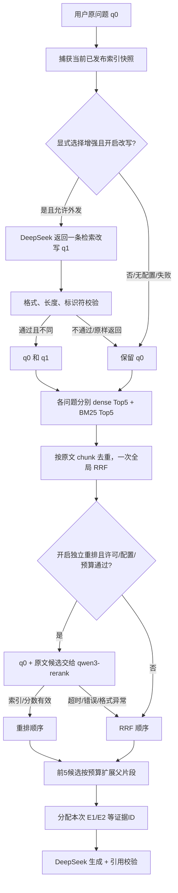

# Query 改写与独立重排接入说明

**2026-11-02 最新状态：**用户已提供配置并授权真实联调，两题改写＋重排＋生成及引用回查已通过，共 6 次模型调用，台账上界 0.009703 元。服务和增强开关已开启；下文 11 月 1 日的默认关闭及未联调描述属于实现时状态。详情见 [本次真实验收](P2真实链路验收-2026-11-02.md)。

更新日期：2026-11-01。用户已授权先实现代码，再提供 API。本次只做代码、模拟接口测试与说明，没有启动后台服务、下载模型或执行付费请求。

## 1. 实际完成了什么

| 能力 | 状态 |
|---|---|
| Query 改写 | 已实现，可选调用 DeepSeek，复用生成密钥 |
| 原问题＋改写问题各路 Top 5 | 已实现，当前每个问题分别检索本地 dense 与 BM25 |
| 一次全局 RRF、按原文 chunk 去重 | 已接入；最多四路、约 20 个唯一候选 |
| 独立 Reranker | 已实现百炼 `qwen3-rerank` 原生 HTTP 适配器 |
| 重排 → small-to-big → 引用生成 | 已接入，模拟 API 链路测试通过 |
| 外发许可、统一费用台账与失败回退 | 已接入改写和重排 |
| 真实付费 API 联调 | 未执行，等待用户自己的 API 与价格核对 |
| BGE-M3 远程 dense/sparse | 仍未接入；当前 BM25 不能称为 BGE-M3 sparse |
| 多轮问题补全、会话记忆 | 仍是 P3 范围，本次没有实现 |

新增功能均默认关闭。现有索引可以继续使用，不需要为了改写或重排重建；未来切换 BGE-M3 编码模型时才需要新索引。

## 2. 增强链路怎么运行



原问题永远保留，改写是额外检索变体，不会替换用户需求。模型如果原样返回，不增加两条重复路给同一问题重复投票。请求中没有会话历史，也不会自动猜“它”“那个”指代什么。

目前四条路的名字为 `dense`、`bm25`、`dense_rewrite`、`bm25_rewrite`，使用现有本地 bge-small 编码器。各路按 chunk 去重后最多 5 条，合并只执行一次 RRF，保留各路排名与原始分数。

重排使用**原问题 q0**和“标题＋章节＋原文子片段”，将其作为本次单轮的明确用户意图；不会把改写中可能新增的假设升级为用户条件，也不会把生成答案交给重排模型。未来多轮可以在已确认条件基础上生成独立问题，另做接入。

重排请求返回全部候选的排序，应用按返回的 `index` 找回自己持有的原文，不信任服务返回的文本来替换原文。校验数量、唯一索引、范围与有限数值分数；重排分数单独保存在 `rerank_score`，不覆盖 `rrf_score`，也不是答案正确概率。

改写校验能拦截空值、超长、重复 JSON 键、额外字段、控制字符及英文标识符/数字明显丢失，**不能证明语义完全等价**，所以轨迹明确记录未验证语义；仍需后续业务评测。

## 3. 等你提供 API 后配置什么

不要直接用示例文件覆盖已经配置好的 `.env`，只合并需要的字段。密钥仅填在本机，不能发到聊天、提交 Git 或写进示例。

| 配置 | 作用 |
|---|---|
| `RAG_ALLOW_EXTERNAL_CALLS=true` | 总开关，当前本机仍保持 false |
| `RAG_QUERY_REWRITE_ENABLED=true` | 允许增强入口尝试改写 |
| `RAG_DEEPSEEK_API_KEY` | 用户自己的 DeepSeek Key，改写与生成共用 |
| `RAG_DEEPSEEK_MODEL=deepseek-flash` | 沿用既定生成型号 |
| `RAG_RERANK_ENABLED=true` | 允许增强入口尝试独立重排 |
| `RAG_RERANK_API_KEY` | 用户自己的百炼 Key |
| `RAG_RERANK_ENDPOINT` | 对应自己地域/业务空间的完整原生重排 URL |
| `RAG_RERANK_MODEL=qwen3-rerank` | 已确认型号，不自动切换其他模型 |
| `RAG_RERANK_INPUT_CNY_PER_MILLION` | 核对后的每百万输入 token 人民币价格 |
| `RAG_RERANK_PRICE_VERIFIED_ON` | 核价日期，`YYYY-MM-DD` |
| `RAG_RERANK_PRICE_VALID_THROUGH` | 本项目核价记录有效截止日期，`YYYY-MM-DD` |
| `RAG_RERANK_MAX_INPUT_TOKENS=16000` | 本次重排保守输入预算上限 |
| `RAG_MONTHLY_BUDGET_CNY=50` | 项目全部受控模型调用共用的月预算 |

重排 endpoint 路径是 `/api/v1/services/rerank/text-rerank/text-rerank`，域名按百炼账户与地域填写；不硬编码一个可能与用户账户不匹配的地址。当前适配器只允许官方 `*.aliyuncs.com` HTTPS 原生地址，不支持将其他厂商 OpenAI 兼容接口直接填入。参考 [百炼原生 API 文档](https://help.aliyun.com/zh/model-studio/text-rerank-api)。

Reranker 价格留空会阻止发起该调用，不按免费处理。DeepSeek 原有价格卡也有有效日期，真实联调前需要重新核对；填写 Key 不会绕过价格过期检查。若最终换成其他服务商，需要修改相应适配器和计价规则，不能只换 URL。

## 4. 怎样调用

普通 `search` 与本地证据预览默认不调用远程增强，即使服务器配置了 Key 和增强开关也保持本地行为。

```powershell
# 本地基线，不调用远程服务
uv run --no-sync python -m debug_rag.cli search --kb demo-debug --question '文件导出取消后需要清理什么？'

# 显式请求增强：仍需上述环境配置与预算检查通过
uv run --no-sync python -m debug_rag.cli search --kb demo-debug --question '文件导出取消后需要清理什么？' --enhanced

# 增强检索并预览父片段上下文，不调用最终答案生成；改写/重排仍可能计费
uv run --no-sync python -m debug_rag.cli context --kb demo-debug --question '文件导出取消后需要清理什么？' --enhanced

# 增强检索后生成回答，需要生成 API，同样计入总预算
uv run --no-sync python -m debug_rag.cli ask --kb demo-debug --question '文件导出取消后需要清理什么？' --enhanced
```

API 约定：

| 入口 | 行为 |
|---|---|
| `POST /api/v1/search` | 固定本地基线；拒绝额外 `enhanced` 字段 |
| `POST /api/v1/search/advanced` | 显式增强检索，正文仍是 `kb_id` 和 `question` |
| `POST /api/v1/context` | 可选 `enhanced: true`；默认 false |
| `POST /api/v1/chat` | 可选 `enhanced: true`；默认 false |

页面增加“增强检索 · 需 API”按钮，以及生成回答时的增强复选框。原来的本地检索和本地证据预览不受复选框影响。页面查看轨迹能区分：开关已开启、实际执行成功、回退原因。

## 5. 出错、许可与费用怎么处理

- 改写超时、结构无效或缺配置：使用原问题，最多执行一次改写请求，不自动修复重试。
- Reranker 失败：保留原有 RRF 顺序，`rerank_applied=false`，`degraded=true`，记录维护过的错误码，不返回厂商错误正文或密钥。
- 请求未发送：不创建收费调用记录；已发送后费用未知：保留预留金额，不当作免费。
- 重排返回 `usage.total_tokens`，转成台账输入 token 用量，按该调用保存的百炼价格结算；不使用 DeepSeek 的价格计算重排费用。
- 预留估算按每个文档重复计入 query；超过配置输入上限时回退，不悄悄裁剪原文。缺失/过期价格、预算不足都会在网络调用前拦截。
- 改写只发送问题，不发送文档。为遵守当前资料边界，库中存在已交付但禁外发的资料时，增强链路保守跳过远程改写。
- 重排前检查**全部实际候选**的外发许可，不能等最终生成阶段才检查。任一候选禁外发，本次跳过整个远程重排，保留本地结果。
- 生成前仍检查最终实际父/子证据的许可。父片段来自检索开始时捕获的同 generation/revision，不读取之后新发布的其他版本。

`api_calls` 保留改写、重排及生成的调用标识与用量；失败且已发送的请求同样计入 `external_calls_executed`。实际是否产生费用还需核对供应商账单，本地台账使用保守上界。

## 6. 从代码哪里开始读

1. `retrieval/rewrite.py`：改写提示、结构校验与保留用户显式标识符。
2. `retrieval/service.py`：单快照、各路召回、一次融合、可选重排、可追踪回退。
3. `retrieval/rerank.py`：独立百炼协议、原文索引校验、输入与外发限制。
4. `budget.py`：多供应商共享台账、每条调用保存独立价格、原子预留与结算。
5. `components.py`：给服务注入改写器、重排器与同一预算实例。
6. `tests/unit/test_retrieval_enhancements.py`：通过 MockTransport 观察顺序、字段、费用和失败行为。

本次软件测试不能代替真实模型效果评测。需要 API 后验证实际地址、模型权限、计费与协议，再对固定问题集比较“基线／只改写／只重排／两者都开”的检索质量、延迟与成本。
