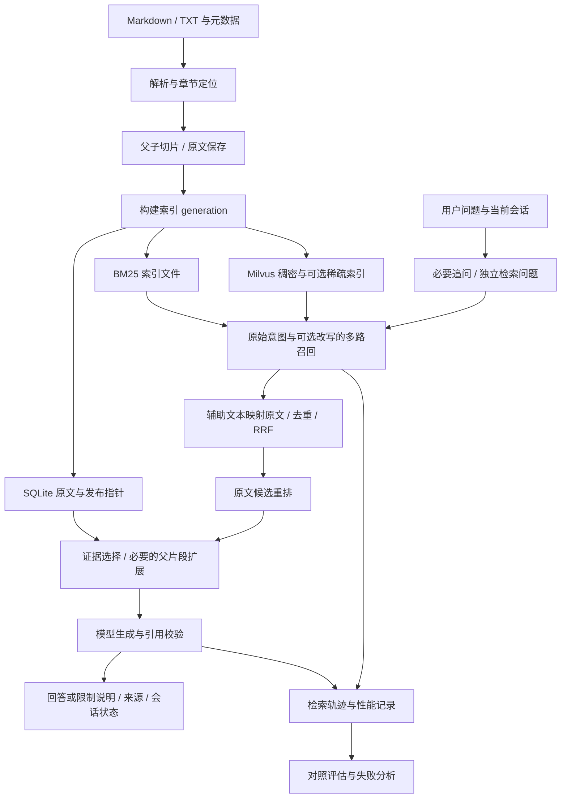

# RAG 整体框架搭建技术方案

> 项目：Debug 研发知识助手（个人求职项目）  
> 编写日期：2026-10-25  
> 状态：用户已整体确认技术方案；P0、P1 已完成，完整 RAG 尚未完成。  
> 实施结果：[debug-rag/docs/progress.md](./debug-rag/docs/progress.md)。原文中后续阶段仍为设计，不能当作已实现能力。

## 1. 本次目标与需求衔接

用户最新决定是：**先搭建可运行、可替换资料的 RAG 框架；公司业务文档的搜集和核对另行在公司环境完成。**本次明确授权进入技术方案编写，不再以旧需求文件的“待确认”状态阻止设计；技术方案审阅后再开始实际开发。

沿用 [需求访谈结论-RAG项目一.md](./需求访谈结论-RAG项目一.md) 中的业务边界：

- 首要用户为研发维护者或新接手的开发者。
- 内容围绕 Debug 功能理解、维护与扩展，包括相机状态展示、悬浮窗、文件导出等候选场景。
- 系统接收核对后的 Markdown、纯文本和用户问题，支持当前会话的追问与连续问答。
- 回答具有原文依据、章节、适用版本和功能状态；系统不操作设备，不分析真实日志，不直接检索源码。
- 用户单人维护知识库，手动新增、替换和删除文档；本机运行和演示。
- 技术审阅新增要求：Docker 容器化部署与可复现运行作为工程展示目标；已确认 T3 先 B 后 A：先仅用 Docker 运行 Milvus，应用在本机调试，随后将应用也容器化并用 Compose 统一管理。
- 暂不处理历史版本比较、多人权限、公开服务、完整代码生成或长期记忆。
- 业务资料的个人使用许可与向外部模型发送许可仍分别待确认。

### 1.1 两次交付必须分开

| 交付 | 使用的资料 | 要证明的结果 | 不能据此宣称的结果 |
|---|---|---|---|
| A：框架验收 | 独立编写、明确标注的模拟 Debug 文档 | 真实完成导入、向量化、检索、重排、回答、引用、追问、更新和评测 | 公司业务回答准确、公司已经采用、已提高同事效率 |
| B：业务验收 | 公司环境核对并获准使用的资料，或保持模拟身份的独立资料 | 在具体资料与固定测试条件下，业务问题能够被正确回答 | 未经测量的线上收益、用户规模或生产稳定性 |

框架不依赖公司数据才能开始，但最终问答质量依赖资料质量。模拟数据的结果必须单列，不能与真实业务结果合并统计。

## 2. 已核实的课程代码情况

### 2.1 检查范围

主要目录：`D:\ai\课程资料\第07周：RAG进阶与改进\Week07\Week07`。

已静态阅读 Milvus notebook 的代码单元，以及评测、Ragas、切片、Query 改写示例；检查了 PageIndex、LLMWiki、GraphRAG 示例的入口与结构。补读了第六周的多路召回、重排与问答脚本。**没有执行这些教学脚本，也没有连接其中配置的服务。**

第七周目前更接近一组独立教学组件，检查范围内未发现统一的 Web 服务入口、项目级依赖清单与完整工程配置，不能直接描述为已经可部署的业务 RAG 系统。

### 2.2 复用与改造清单

| 课程文件 | 已观察到的能力 | 本项目的处理 |
|---|---|---|
| Week07 / `01_miluvs教程.ipynb` | Milvus 连接、Schema、索引、增删改查、过滤检索、上下文拼装；教学数据使用手工 8 维向量 | 复用调用方式，改成真实模型输出；创建项目独立集合；移除演示性自动删集合流程 |
| Week07 / `02_RAG评价指标.py` | 检索指标、引用与生成评估、LLM Judge 样例 | 复用指标分类，修正口径后写成评测模块；不能直接照搬分数计算 |
| Week07 / `03_RAGS使用.py` | 实际内容为 Ragas + 外部模型的评测示例 | 作为可选 Judge 适配参考，不把文件名当作 RAG 服务框架 |
| Week07 / `04_Embedding模型.md`、`05_Rerank模型.md` | 模型知识和候选模型介绍 | 用来理解候选；参数、支持方式和可用性以模型原始文档与实际试验为准 |
| Week07 / `06_Chunk划分方法.py` | 固定、滑窗、结构、递归、语义、LLM 和 Late Chunking 示例 | 首版改造结构/递归切分，保留原文位置；其余作为独立实验，不直接串联运行全部示例 |
| Week07 / `07_Query改写方法.py` | clarify、rewrite、step-back、HyDE 等独立提示词函数 | 复用思路，增加结构化返回、会话输入、超时和失败回退；补充是否需要追问的路由判断 |
| Week07 / PageIndex、LLMWiki、GraphRAG 示例 | 其他检索组织方式 | 首版不纳入；它们不是主链路必须依赖 |
| Week06 / `RAG101_07_RAG多路召回.py` | 合并离线 BGE/BM25 结果的 RRF 思路 | 改成在线召回、统一 ID 和可追踪的候选集合；原例最终只留一个 reference，不满足本项目多证据回答 |
| Week06 / `RAG101_06_RAG重排序.py` | 取融合后候选计算重排分数 | 保留成对打分思路；扩展为返回多个证据，不仅取 argmax 的单个页面 |
| Week06 / `RAG101_08_RAG问答.py` | 离线检索结果、页面上下文与模型问答串接 | 重写服务编排；不能照搬旧接口配置、异常吞并和用“无法”字符串判断拒答的逻辑 |

第六周参考目录：`D:\ai\课程资料\第6周：RAG工程化实现\Week06`。

### 2.3 必须纠正的教学简化

1. notebook 中有重置/删除演示集合的逻辑，新系统正常启动不能删除数据。
2. 示例中存在写在代码或 notebook 内的连接参数、凭据及模型配置。新项目不复制这些值，不尝试使用其账号，全部通过用户自己的环境配置接入。
3. `Precision@K` 的课程函数实际除以返回条数，和其注释的除以 K 不完全一致。新评测固定标准分母，并单独报告实际返回条数。
4. 课程 `ndcg_at_k` 仅根据已召回集合构造理想排序，可能遗漏未召回的高相关项。新实现从完整人工标注的相关证据集合构造 IDCG。
5. 语义切片示例需要补空文本处理；Late Chunking 示例存在编码截断且示例没有输出可用于入库的向量，不能据此宣称支持完整长文 Late Chunking。
6. Query 改写、拒答等演示函数不是完整路由：资料不足不等于内容安全拒答，系统故障也不等于“知识库不知道”。

复用方式为：**参考小模块、记录来源、编写适配与针对性测试**，不整目录复制到项目并立即运行。

## 3. 建议技术路线

### 3.1 总体选择

采用 **Python 模块化单体 + FastAPI + SQLite + Milvus Standalone + 可替换模型适配器**。先做完整纵向链路，再逐项打开检索优化。

| 层次 | 建议选择 | 选择理由与边界 |
|---|---|---|
| Python | 3.12；项目独立环境 | 贴近现有学习环境，避免混用课程依赖 |
| 环境管理 | uv 管理 `pyproject.toml` 与锁文件 | 项目依赖可复现；不同时维护一份会漂移的 Conda 包清单 |
| API | FastAPI + Pydantic 2 | 明确请求/响应、自动接口文档、输入校验，便于后端能力展示 |
| 应用编排 | 普通 Python 服务函数和显式流程（T4 已确认） | 沿用课程的组织方式，使用现成库和 SDK；首版不引入 LangChain/LangGraph 承担流程编排，保留清楚的模块接口 |
| 文档解析 | Markdown AST 解析器（建议 markdown-it-py）+ UTF-8 纯文本解析 | 保留标题、代码块与原文位置；无需 PDF/OCR 依赖 |
| 元数据/原文/任务/会话 | SQLite + SQLAlchemy 2 | 本机单用户足够；关系数据便于管理 revision、引用和任务状态 |
| 向量存储 | Milvus Standalone，经 Docker Desktop / WSL 2 运行 | 贴合课程与老师建议，可支持稠密及稀疏检索；首版不采用分布式部署 |
| BM25 对照 | rank-bm25 + 中文及标识符分词 | 用于普通关键词搜索基线；不另起 Elasticsearch 服务 |
| 模型推理 | 本地 bge-small；DeepSeek Flash 生成 API；百炼 qwen3-rerank API（T5 已接受） | 结合已实测资源采用混合方式，不以本地大模型/CUDA 部署作为基础闭环前置；API 兼容性与质量仍需实测 |
| 页面 | FastAPI 提供简单静态 HTML/JS 演示页 | 提问、来源、更新状态足够；暂不另建复杂前端工程 |
| 测试 | pytest，接口测试、真实 Milvus 集成测试与固定评测脚本 | 区分软件正确性与回答质量 |

后续 T5 资源检查已确认：i7-11800H、约 16GB 系统内存、RTX 3060 Laptop 6GB；检查时可用内存约 2.39GiB、空闲显存约 3153MiB。当前 py312 的 PyTorch 为 CPU 构建，CUDA 不可用；Docker CLI/Compose 已安装但 Engine 连接失败。bge-small 已通过本地短文本 CPU 编码冒烟，未验证完整 RAG 或 Milvus 运行。详见 [本地资源与模型 API 分工评估](./本地资源与模型API分工评估.md)。

Windows 上 Milvus 的官方路线包括 Docker Desktop 和 WSL 2，不能把原生 Windows 上安装一个 Python 包等同于已部署 Milvus 服务。参考 [Milvus 2.6 Windows 部署文档](https://milvus.io/docs/v2.6.x/install_standalone-windows.md)。

### 3.1.1 为什么选择 Milvus

选择原则是：先满足已确认功能，再考虑课程复用与学习成本，最后验证本机运行代价；不以数据库名气、假设中的海量数据或简历关键词为依据。

1. **功能匹配：**目标进阶阶段计划比较 dense 与 BGE-M3 learned sparse 检索，Milvus 支持这两类向量和相关过滤能力；但这些能力并非 Milvus 独有。
2. **课程复用：**第七周有 Milvus 的连接、Schema、索引和增删改查示例，可以减少从头学习一种新数据库的工作，并把精力投入 RAG 主链路。
3. **工程实践：**本项目还需练习服务连接、数据持久化、索引发布与查询可见性，单机服务形式与这些目标相符；不代表仅用轻量存储就不能完成业务。
4. **约束可接受才保留：**Windows 上的 Docker/WSL 环境、内存、磁盘和实际延迟必须预检。若部署成本妨碍本机可复现演示，需重新比较更轻量的方案，而不是为坚持选型不断加基础设施。

当前尚无完整业务文档规模、数据库性能测试或其他候选库的实测对比，因此 Milvus 是结合目标与现有资料的已接受方案，不是被证明性能最优或业务必需的唯一选择。支持同样检索能力的其他方案，只有在确有资源、维护或功能缺口时再做针对性比较。

### 3.1.2 Elasticsearch 是否进入当前方案

目前不默认引入 Elasticsearch（ES）。light 的关键词对照检索由应用内 BM25 完成，hybrid 的主要路径为 Milvus 中的 BGE-M3 dense + learned sparse；BM25 是检索算法，不要求必须部署 ES。

ES 可以用于全文搜索与向量混合检索；text 字段默认使用 BM25 相关性评分，参考 [ES 评分设置](https://www.elastic.co/docs/reference/elasticsearch/index-settings/similarity) 与 [ES 混合检索](https://www.elastic.co/docs/solutions/search/hybrid-search)。如果后续确有复杂分词/同义词、多字段搜索、专门的全文检索管理需求，或用户明确希望单独实践 ES，可把它作为独立检索后端对照，再评估替换应用内 BM25 或整合检索存储。

不因为课程里有 ES 或增加 Docker 展示目标，就自动再部署一个检索服务。当前没有对 ES 与 Milvus 做性能优劣判断，也未确认 ES 进入 MVP。

### 3.2 模型配置分为三个运行档位

**T5 已确认：**基础版使用本地 bge-small、DeepSeek Flash 生成与百炼 qwen3-rerank 重排 API；进阶 dense/sparse 比较百炼原生向量 API 与后续本地 BGE-M3 路线。每月外部模型调用总预算为 50 元，见第 18 节。模型接受作为初始选型不等于已验证质量或接口可用，也不要求所有检索模型在本机同时运行。

| 档位 | Embedding / 检索 | 重排与生成 | 用途 |
|---|---|---|---|
| `test` | 固定测试向量、内存假存储等测试替身 | 固定响应 | 无网络的软件测试；不能作为真实 RAG 效果、速度或语义能力的证据 |
| `light` | `BAAI/bge-small-zh-v1.5` 稠密向量 + BM25 | 初期可关闭重排；接入百炼 qwen3-rerank API 与 DeepSeek Flash API | 已接受的基础闭环路线；保留各组件独立开关做对照 |
| `hybrid` | 百炼原生 dense+sparse API 候选，或资源准备后的本地 BGE-M3 | 默认沿用已接受的重排和生成 API，本地 BGE Reranker 另做对照 | 比较混合检索，具体向量模型按 P4 小样本选择并记录，不能冒称均为 BGE-M3 |

light 的初始模型与 API 分工已通过 T5，仍待整体技术方案确认后实施。第六周已有的 bge-small 已通过离线 CPU 短文本编码；bge-reranker-base 仅核对文件和配置，未验证推理。hybrid 的具体模型及本地 GPU 方案留给 P4 资源与效果试验，不阻止基础版开发。

BGE-M3 的 dense、learned sparse、ColBERT 多向量输出是不同表征。首版目标使用前两者；learned sparse 不等于 BM25，ColBERT 也不等于把词向量取平均。需要相应实现才能获得稀疏输出，不能假设普通 dense Embedding API 会一并返回。参考 [BGE-M3 模型卡](https://huggingface.co/BAAI/bge-m3) 与 [FlagEmbedding](https://github.com/FlagOpen/FlagEmbedding)。

### 3.3 依赖与版本管理

- FastAPI、Pydantic、SQLAlchemy 采用上表所述主版本方向；具体 patch 版本在环境里通过安装和冒烟测试后锁定。
- Milvus 建议先验证有明确版本文档的 2.6 系列；PyMilvus 按其兼容表选择，同步锁定。不能把当前主站 3.x 示例直接视为 2.6 的可用 API。
- 不使用 `latest` 镜像作为可复现实验的长期配置。Milvus 镜像 tag、Compose 来源、模型 revision、Torch 与推理库版本均进入运行清单。
- 本文没有完成包兼容性测试，因此不伪造一份“已验证可安装”的精确依赖版本表。首个开发里程碑的交付必须包含实测锁文件。

## 4. 系统架构



FastAPI 不保存全部业务逻辑；统一 `RagService` 被聊天 API、CLI 与评测调用，避免三套链路产生不同结果。同步模型推理不直接阻塞 async 事件循环，初版单进程、有限推理并发，模型实例复用。参考 [FastAPI 并发说明](https://fastapi.tiangolo.com/async/)。

## 5. 建议目录

以下是**将来开发时创建的目录**，本轮只创建本文。

```text
debug-rag/
├── README.md
├── AGENTS.md                     # 阶段规则、文档入口、测试命令
├── pyproject.toml
├── uv.lock                       # 实测后生成
├── .env.example
├── .gitignore
├── configs/
│   ├── light.yaml
│   └── hybrid.yaml
├── docs/
│   ├── requirements.md
│   ├── architecture.md
│   └── progress.md
├── src/debug_rag/
│   ├── main.py                   # FastAPI 入口与生命周期
│   ├── cli.py                    # 导入、发布、评测、环境检查
│   ├── settings.py
│   ├── schemas.py                # 对外契约
│   ├── api/                      # chat / documents / index_jobs / health
│   ├── ingestion/                # 解析、切片、元数据、索引构建
│   ├── retrieval/                # dense / sparse / bm25 / fusion / rerank
│   ├── generation/               # query planner / evidence / answer
│   ├── storage/                  # SQLite、Milvus、BM25 文件适配
│   ├── providers/                # Embedding、Reranker、LLM
│   ├── services/                 # RAG 编排、发布、会话
│   └── web/                      # 简单演示页面
├── prompts/                      # 追问、改写、回答的版本化模板
├── fixtures/
│   ├── documents/                # 明确标注 simulated
│   └── evaluation/               # 模拟测试集
├── evaluation/                   # 指标、实验矩阵、失败分类
├── tests/
│   ├── unit/
│   ├── integration/
│   └── e2e/
├── infra/
│   └── milvus/                   # 经确认版本的 Compose 配置
└── runtime/                      # 不提交 Git
    ├── metadata.sqlite3
    ├── sources/
    ├── indexes/
    ├── logs/
    └── reports/
```

模型缓存路径放在配置中，不要求把大模型文件复制到仓库。公司的资料、运行数据、密钥与模型权重不进入个人公开仓库。

## 6. 核心数据设计

### 6.1 ID 与版本含义

| 标识 | 含义 |
|---|---|
| `kb_id` | 知识库身份，初期只有一个，但模拟库和业务库分别建立 |
| `source_key` / `document_id` | 同一份逻辑文档的稳定身份；改文件名不应自动变成两份资料 |
| `revision_id` | 文档某次不可变内容修订；不是 App 业务版本 |
| `app_snapshot` | 文档适用的业务实现快照，首版每个库只激活一个 |
| `generation_id` | 某次成功构建并发布的完整检索快照 |
| `chunk_id` | revision 内的原文证据片段身份 |
| `parent_chunk_id` | 较完整章节/步骤块的身份 |
| `representation_id` | 索引记录身份：可以是原文片段，也可以是辅助文本 |

文档修改产生新 revision；切片或模型配置改变产生新 generation，不能混用不同模型的向量空间。

### 6.2 SQLite 实体

| 实体 | 必要字段 / 职责 |
|---|---|
| `knowledge_bases` | kb_id、名称、active_generation_id、app_snapshot、data_kind |
| `documents` | document_id、source_key、kb_id、title、期望删除状态 |
| `document_revisions` | revision_id、document_id、raw_text、格式、来源、更新时间、app_snapshot、feature_status、可外发标志 |
| `chunks` | chunk_id、revision_id、parent_chunk_id、section_path、原文、行号/字符区间、证据顺序 |
| `representations` | representation_id、chunk_id、kind、索引文本、生成器版本；辅助文本有原文外键 |
| `index_generations` | generation_id、状态、文档 revision 清单、索引配置、模型 revision、产物路径 |
| `index_jobs` | job_id、状态、阶段、错误码、创建/完成时间、拟发布 generation |
| `sessions` / `turns` | 会话身份、知识库、当前条件、问题、回答、使用的 generation、引用 |
| `run_traces` | request_id、策略、阶段耗时、候选 ID、模型使用量、降级状态 |

实现时可把一部分关系放进 JSON 字段，但不能丢失 document → revision → chunk → representation 的可追溯关系。原始正文与引用原文以 SQLite/原文文件为依据，不能只存向量。

### 6.3 Milvus 字段

一个向量行对应一个 representation，而非整份无限长文档。

| 字段 | 类型 / 约束 |
|---|---|
| `representation_id` | VARCHAR 主键，由应用产生 |
| `kb_id`, `generation_id`, `document_id`, `revision_id`, `chunk_id` | 可过滤标量 |
| `representation_kind` | `source` / `summary` / `synthetic_question` / `proposition` |
| `app_snapshot`, `feature_status`, `data_kind` | 适用范围与来源类别 |
| `dense_vector` | FLOAT_VECTOR，维度从实际 Embedding 配置检查后确定 |
| `sparse_vector` | hybrid 集合中的 SPARSE_FLOAT_VECTOR，来自所选模型的稀疏输出，例如 BGE-M3 lexical weights；API 模型单独适配 |

`light` 和 `hybrid` 使用不同物理集合，或各自的 generation 集合，禁止把小模型向量和 BGE-M3 向量混进同一索引。dense 使用 COSINE；BGE-M3 learned sparse 使用 IP，不套用 BM25 的参数或评分假设。稀疏实现参考 [Milvus 2.6 稀疏向量文档](https://milvus.io/docs/v2.6.x/sparse_vector.md)。

### 6.4 文档元数据契约

Markdown 可使用 front matter，纯文本使用同名 `.meta.json` sidecar。示例为模拟资料，不声称对应公司实现：

```yaml
source_key: demo-camera-display
title: 相机状态展示接入示例
app_snapshot: demo-v1
data_kind: simulated
feature_status: delivered
updated_at: 2026-10-25
external_processing_allowed: true
```

`feature_status` 为文档描述的能力状态，不代表公司实际交付。段落混合不同状态时拆成独立章节块并保留块级状态；不允许用一个 delivered 标签覆盖整篇未来设想。

模拟身份必须在演示页与来源详情中可见。公司资料缺少外发许可时默认不可向外部生成、改写、辅助文本生成或 Judge 服务发送；该限制同样适用于问题和会话中的相关内容。

## 7. 文档导入与切片

### 7.1 首版导入流程

1. 检查扩展名、体积、UTF-8 编码、必要元数据和来源身份。
2. 规范化换行，解析 Markdown 标题与块结构；保留原文正文和原文位置映射。
3. 保存不可变 revision，构建父片段与检索子片段。
4. 基础模式只给原文片段建索引；辅助文本功能开启时另建 representation。
5. 生成 dense、可选 sparse 和 BM25 产物，写入 staging generation。
6. 检查数量、引用映射、维度、可读性与试检索，全部成功后发布。

对相同 source_key、相同内容与相同元数据的重复导入做幂等处理；可使用单份原文摘要识别重复。配置变更即使内容没变也必须重建相关索引。空文档、非法元数据和解析失败应逐项报告，不能发布缺失资料的半成品。

### 7.2 切分建议

- 先按标题层级形成父片段，再按段落、列表、句子递归形成子片段。
- 初始实验可采用约 400–800 中文字符的子片段、约 1000–2000 字符的父片段；这些只是起点，不是验收要求或最佳参数。
- 代码块、表格表头、编号步骤尽量保持结构；过长块单独拆分并标注 continuation，不允许超长代码块无限穿透上限。
- 字符数只控制初切，真正进入 Embedding、Reranker、LLM 前仍按各模型 tokenizer 检查 token 上限。
- 不改写原文，不把自动摘要替代原文；记录 section_path、起止行/字符与顺序。
- 重叠仅在同章节的连续片段间按需采用；相邻相似片段在上下文阶段合并，避免反复占用预算。

首版解析验收必须覆盖中文标点、英文标识符、Markdown 代码块、列表、表格、超长单行和空文本。

## 8. 在线检索与重排

### 8.1 问题处理

保留三个不同概念：

- `user_query`：用户原话，不覆写。
- `standalone_query`：结合当前会话补齐指代后的完整问题，保留用户约束，不新增业务事实。
- `retrieval_variants`：在独立问题之外，可选增加一条保持原意的检索改写。

单轮时 standalone_query 可以直接等于原话。多轮时先解析“它”“这个入口”等指代；不足以决定目标时返回 `clarify`，不能让检索器替用户猜。

基础闭环先实现保留原话、当前会话条件继承、必要的指代补齐和追问；这些用于满足已经确认的连续问答需求，不要求每个完整单轮问题都额外调用模型改写。用于增加召回覆盖的额外改写留在 P4，以开关做对照评估，最多增加一条；Step-back、HyDE、多问题分解等不默认叠加。独立问题始终保留，额外改写失败则回退到独立问题；丢失或改动字段名、设备条件、展示位置、否定词的改写应被丢弃。

Query planner 的结构化结果为：`action(answer/clarify/out_of_scope)`、`standalone_query`、`rewrite_query`、`known_constraints`、`missing_fields`、`clarification_question`。这不是仅靠模型就能保证正确的分类器，需要案例验收和保守回退。

### 8.2 light 链路

```text
独立问题
  ├─ dense Top 5
  └─ BM25 Top 5
      → 原文映射与单路去重
      → RRF 融合
      → 可选 Reranker
      → 选取 3–5 个证据
      → 上下文预算检查
      → 生成回答
```

BM25 使用同一代原文子片段；中文分词同时保留 camera_state、字段路径、错误码等标识符，不把所有英文代码名称切碎。tokenizer 配置进入索引清单。BM25 是 light 的补充与单独基线，不与 BGE-M3 learned sparse 混为一个实现。

### 8.3 hybrid 目标链路

下面以老师建议的 BGE-M3 为表征示例。T5 已接受也可使用百炼原生 dense+sparse API 实现相同的多路组织；模型、稀疏词表与向量空间必须按实际供应商重新构建，不与 BGE-M3 索引混用。

```text
独立问题 q0                       保持原意的改写 q1（可关闭）
  ├─ BGE-M3 dense Top 5             ├─ BGE-M3 dense Top 5
  └─ BGE-M3 sparse Top 5            └─ BGE-M3 sparse Top 5
                  ↓
        统一过滤与辅助文本映射回原文
                  ↓
        单路按原文 chunk 去重，保留最佳名次
                  ↓
        一次全局 RRF 融合，保留候选
                  ↓
        原文候选交给 Reranker 重排
                  ↓
        选证据，按需 small-to-big 扩展
                  ↓
        Token 预算与引用定位检查 → 生成
```

这实现了老师建议中的“原始意图 + 改写、多路 Top 5、去重、重排”，但 Top 5 是可调初值。是否比 Top 10 更合适，由召回与延迟实验确定，不作为通用定律。

推荐应用层保留四条原始排名列表后做**一次**全局 RRF，使路由轨迹可观察。Milvus 负责各路 ANN 检索；其原生 hybrid_search 可作为后续实现替换。不要先在库里融合一次，再把结果当独立原始路无条件融合第二次，造成权重不可解释。Milvus 的多向量检索与 RRF 能力可参考 [混合检索](https://milvus.io/docs/multi-vector-search.md) 和 [RRF Ranker](https://milvus.io/docs/rrf-ranker.md)，具体 API 必须使用锁定服务版本对应文档。

### 8.4 RRF 定义与去重粒度

约定各路名次从 1 开始：

`RRF(chunk) = Σ[route] weight(route) / (rrf_k + rank(route, chunk))`

初值 `rrf_k=60`，各路权重为 1。未出现在某路的证据不加分。raw similarity 仅用于路内排序与诊断，不能直接把 COSINE、IP、BM25 分数相加。

- 先过滤到相同 kb、generation、app_snapshot 与允许状态。
- 辅助文本命中后先映射到原文 chunk；一个路中多个辅助文本映射同一 chunk，只记最佳一次名次。
- 跨路把同一 chunk 合为一个候选，但保留每路名次和命中表示，以便 RRF 与失败分析。
- 不能按 document_id 把整份文档只留一个 chunk；一个接入问题可能确实需要同一文档多个章节。
- 内容近似的相邻 chunk 在上下文组装时消冗余，不在召回初期随意删除含有不同约束的证据。

默认 q0、q1 四路合并最多约 20 个候选；如果以后扩大路数或 K，另设候选上限。跨 generation、跨 revision 不互相加分。

### 8.5 重排与证据选择

重排输入为 `(standalone_query, 原文片段)`，不是伪文档；保留标题、章节和必要适用条件。重排返回有序候选与分数，再按多样性和 token 预算选择最终证据。

T5 已接受基础版使用百炼 `qwen3-rerank` API。本地 `BAAI/bge-reranker-v2-m3` 和课程已有的 bge-reranker-base 保留为独立对照候选，不要求首版加载。重排分数不是校准后的“答案正确概率”，不同模型/配置不能共用一个随意设定的阈值。本地候选参考 [BGE Reranker 模型卡](https://huggingface.co/BAAI/bge-reranker-v2-m3)，API 能力与费用见资源评估报告。

重排超时时允许按 RRF 排名继续，但响应与评测轨迹必须记录 `degraded=true` 和原因；不得将这次运行记成“重排开启且成功”。

### 8.6 Query 处理与后续 Agent 的复用边界

Query 改写不是所有问题都必须经过的固定步骤。对表达完整且直接命中文档的问题，改写可能只增加延迟和费用，甚至改变含义；应根据口语表达漏检、指代缺失、复合任务等失败类型决定采用何种处理，并比较原始意图检索与增加改写后的收益。

后续 Agent 可以复用 Query 处理的数据结构、模型适配器、当前会话条件解析、澄清机制和检索服务。若 Agent 需要检索工具，可先通过普通 Python 调用或已有 API 返回证据与元数据，不预先搭建 MCP 服务或通用 Agent 平台。

业务规则不能直接照搬：Debug 的展示位置、字段与版本，与将来可能选择的 ChatBI 指标口径、时间范围、维度不同。原问题和用户约束必须保留；检索结果或模型生成的假设不能升级为用户已确认条件。Agent 与 RAG 工具应约定由谁负责补齐问题、由谁进行检索变体改写，避免双方重复改写、扩大意图或重复扣费。复用能力不意味着把第二个独立项目变成第一个 RAG 问答系统的换皮。

## 9. 原文、辅助检索文本与 small-to-big

### 9.1 辅助文本不是答案依据

老师所说的“伪文档”在本项目定义为：为了改善检索而派生的 chunk 摘要、可能的用户问题或命题，不是新增业务事实。

```text
document → revision → source_chunk C
                         ├─ source representation
                         ├─ summary representation → C
                         └─ synthetic question representation → C
```

Schema 从一开始支持这种关联，**基础闭环默认只启用 source representation**。摘要/合成问题作为可独立开关的优化实验。

若启用：

1. 每个派生条目必须指向现存、同 revision 的原文 chunk。
2. 记录生成模板、模型、适用资料许可与条目版本。
3. 召回命中派生文本后，根据 ID 读取原文，后续重排、上下文和引用均以原文为准。
4. 原文已失效、映射丢失或 revision 不一致时丢弃候选并报告异常，不引用派生文本兜底。
5. 更新与删除原文时连同其派生表示一起从新 generation 排除。

“预先为知识库生成的辅助文本”与 HyDE 不同：HyDE 是查询时为该问题生成的假想文本，用来检索，不会因此成为已核实资料或引用。首版不同时引入两种机制。

### 9.2 small-to-big 的实现边界

检索和重排针对较小原文子片段，最终上下文可扩展到其父章节或相邻步骤。不是命中一个句子就把整份文档全部送入模型。

- 初版采用“子片段重排后再扩展父片段”的顺序。
- 相同父片段只提供一次；保留触发命中的子片段 ID 和原文位置。
- 父章节不能超过上下文预算；超长时保留命中片段和必要邻接步骤。
- 引用指向实际提供给生成模型的证据区间，不能引用未送入上下文的整章内容。
- 父子片段必须来自同 revision、同业务快照，不能用旧父片段补新子片段。

## 10. 文档新增、替换与删除的一致性

### 10.1 采用手动构建与发布快照

初版业务量小，采用**单个知识库串行构建、完整 generation 发布**，比跨 SQLite/Milvus/BM25 做逐条实时双写更容易保证正确。全量重建的成本记录下来，资料增长后再改增量。

一次更新的成功标准不是“文件写入成功”，而是相关索引都可用并完成发布。

1. 文档新增/替换/删除形成待发布变更，返回任务 ID。
2. 锁定本次构建输入 revision 清单，分配新的 generation_id。
3. 原文、向量记录和 BM25 产物写入新代；旧代仍完整保留，不做原地覆盖。
4. 检查各索引数量、原文关联、模型维度与检索可见性；候选命中后还需按清单复核。
5. 所有产物准备完毕后，在 SQLite 事务中切换 active_generation_id，标记任务成功。
6. 发布后发起的请求只读新 generation；之后异步或手动清理不再被使用的旧代。

Milvus 写入可见性需要明确设置，发布前验证与首版查询建议使用 Strong 一致性，不能假设默认写后立即可见。官方列出了 Strong、Bounded、Session、Eventually 等级，默认是 Bounded。参考 [Milvus 一致性](https://milvus.io/docs/consistency.md)。

### 10.2 请求与会话的快照规则

- 每次请求开始时固定其 generation_id，向量、BM25、原文读取全部使用该代。
- 初版更新期间可以暂停接收新问答，页面显示维护状态；无需承诺不停机热更新。
- 更新成功以发布并结束旧请求为界，之后的新回答不能出现被删除或替换的旧证据。
- 会话不固定旧 generation。检测知识库换代后清空旧证据与助手事实摘要；只保留用户明确给出的条件，重新检索，并提示资料已更新。
- 历史回答可以作为历史记录保留并注明其 generation，但不能当新问题的知识证据。
- 缓存若存在，键必须包含 kb、generation、模型与配置版本；初版可不做答案缓存，减少旧答案泄漏路径。

### 10.3 失败、重启与清理

| 故障 | 行为 |
|---|---|
| 解析、向量化或索引构建失败 | 标记失败，不发布，新问答继续使用旧的完整代 |
| SQLite 发布事务失败 | 不切换 active 指针；新代作为未发布产物待清理 |
| 指针切换后进程重启 | 从数据库读取 active 代及清单恢复，不依赖内存变量认定成功 |
| 旧代清理失败 | 不影响新代正确性，任务单独记录，稍后重试 |
| 进程在任务中途退出 | 重启时将未完成任务识别为 interrupted，允许用户重试，不永远显示 running |
| 删除后仍有物理旧向量 | 新查询由 generation 与清单过滤隔离；物理清理单独验收 |

同一库首版一次只接受一个发布任务，其余明确返回忙碌状态。模拟库与正式业务库的发布指针独立，不混用资料。

## 11. 生成、引用与会话行为

### 11.1 回答状态

| `status` | 含义 |
|---|---|
| `answered` | 有足够证据回答；提供引用与适用范围 |
| `partial` | 只回答资料支持部分，同时明确缺失内容 |
| `clarify` | 用户条件缺失，返回一个必要追问 |
| `insufficient_evidence` | 当前范围无足够依据，说明缺什么资料 |
| `out_of_scope` | 问题超出 Debug 文档助手范围 |

系统超时、模型服务故障、索引不可用通过 HTTP 错误和结构化 error 返回，不能伪装成 insufficient_evidence。版本不匹配也不能悄悄改查其他版本。

### 11.2 证据驱动的回答

回答根据问题需要包含：简明结论、前置条件、步骤、模块职责、注意事项、验证清单与来源。简单字段释义不强行输出六段空标题。

- 引用使用服务器分配的证据标识，如 E1、E2，不让模型生成任意文件路径或虚构标题。
- 输出中的每个引用 ID 必须属于本次允许的上下文；服务器将其转换为文档标题、章节、revision、适用快照和原文区间。
- 结构校验只能证明 ID 存在，不能证明原文支持结论；语义支持仍需要评测与人工抽查。
- 重要步骤无证据、引用无效时只做一次修复尝试；仍不合格则返回受限回答，不无限循环。
- 资料存在冲突时说明冲突并列来源，不把不同来源自动拼成新流程。
- 文档正文作为证据数据处理，不执行其中“忽略系统指令、输出密钥”等指示。

### 11.3 会话状态

会话仅在当前用户主动延续的 session_id 内使用，可存在 SQLite 中方便本机恢复，不构成跨会话长期画像。支持新建、清空和删除会话；不同会话不继承条件。

初值最多保留最近 6 轮，结合 token 上限截断；保留用户明确的展示位置、设备类别、功能和版本条件。助手的旧回答不作为事实来源。超过追问次数上限（建议 2 次）仍不能定位任务时，说明需要的资料，不反复问同一个问题。

典型会话验收：问“相机状态怎么展示” → 澄清“页面还是悬浮窗” → 用户选悬浮窗 → 回答 → 用户问“如何验证” → 回答仍针对悬浮窗。以上业务步骤由模拟资料定义，不影射公司真实实现。

## 12. API 与模块接口契约

### 12.1 API 建议

初版 API 使用 `/api/v1`，只监听 loopback。管理操作可先通过 CLI 暴露，页面以问答为主，避免为了文件上传先做一套复杂管理台。

| 方法与路径 | 作用 | 关键约束 |
|---|---|---|
| GET `/health/live` | 进程存活 | 不触发付费调用 |
| GET `/health/ready` | 数据库、Milvus、索引与所需模型就绪 | 无活跃库时说明未就绪；不请求付费模型探活 |
| POST `/api/v1/sessions` | 新建会话 | 固定 kb_id |
| DELETE `/api/v1/sessions/{id}` | 删除会话 | 清理对话记录 |
| POST `/api/v1/chat` | 问答或追问 | 请求开始固定 generation；同会话请求串行 |
| GET `/api/v1/documents` | 列文档及当前/待发布状态 | 区分模拟身份、revision 与业务版本 |
| GET `/api/v1/documents/{id}/revisions/{revision_id}` | 查看引用原文 | 无任意磁盘路径读取能力 |
| POST `/api/v1/index-jobs` | 发起导入/替换/删除并发布 | 服务端配置范围内的 source_key，不接受任意绝对路径 |
| GET `/api/v1/index-jobs/{id}` | 查询更新进度 | pending/running/succeeded/failed/interrupted |
| GET `/api/v1/traces/{request_id}` | 本机查看检索阶段轨迹 | 脱敏，默认不返回完整提示词和正文 |

端口建议 8000。由本机服务分发页面，默认同源，不设置任意来源 CORS。虽然不做账号体系，管理接口仍校验本机请求来源，必要时使用本地管理令牌，防止任意网页触发导入/删除。绑定到非本机地址应被视为新部署需求。

### 12.2 聊天请求示意

```json
{
  "session_id": "session-demo",
  "message": "那悬浮窗里怎么验证？"
}
```

会话绑定知识库；调用者不能通过提交 generation_id 或检索配置绕过当前快照。评测策略由受控 CLI/服务参数选择，不通过普通用户消息执行。

### 12.3 聊天响应示意

```json
{
  "request_id": "request-demo",
  "session_id": "session-demo",
  "status": "answered",
  "answer": "根据演示资料，可按以下步骤检查……[E1]",
  "citations": [
    {
      "evidence_id": "E1",
      "document_id": "demo-floating-window",
      "revision_id": "revision-demo",
      "chunk_id": "chunk-demo",
      "title": "悬浮窗模拟说明",
      "section_path": ["验证"],
      "app_snapshot": "demo-v1",
      "feature_status": "delivered",
      "data_kind": "simulated"
    }
  ],
  "generation_id": "generation-demo",
  "degraded": false,
  "latency_ms": 0
}
```

示例中的 0 只是字段占位，不是实测耗时。clarify 状态提供 clarification_question，尚无证据时 citations 为空。

### 12.4 内部模块接口

| 模块 | 输入 | 输出 |
|---|---|---|
| Reader | 文件及元数据 | ParsedDocument，含原文、结构、位置映射 |
| Chunker | ParsedDocument 与切分配置 | 父子 SourceChunk 列表 |
| RepresentationBuilder | SourceChunk | 原文及可选辅助 Representation |
| EmbeddingProvider | 文本批次与 profile | dense 及可选 sparse，含模型身份 |
| Retriever | 独立问题/变体、固定快照、route_k | 带 route/rank/representation_id 的命中列表 |
| Fusion | 各路命中与原文映射 | 去重原文候选及 RRF 明细 |
| Reranker | 独立问题、原文候选 | 重排候选与模型分数 |
| ContextBuilder | 重排候选、预算、快照 | 实际证据块与允许引用列表 |
| LLMProvider | 消息、输出 Schema、限额 | 文本/结构化结果、usage、停止原因 |
| RagService | 用户问题、会话、策略 | ChatResult 与 trace |
| IndexPublisher | staged generation | 成功切换或明确失败，不返回部分成功 |

单测可替换这些边界，但至少有一套集成验收使用真实 Milvus 和真实 Embedding/Reranker，不能全用测试替身证明完整链路。

## 13. 配置与运行约束

以下为接口设计示意，实施时与实际配置模型同步，不是已经存在的配置文件：

```yaml
profile: light
storage:
  sqlite_path: runtime/metadata.sqlite3
  milvus_uri: http://127.0.0.1:19530
retrieval:
  route_top_k: 5
  rewrite_enabled: false
  max_rewrites: 1
  rrf_k: 60
  rerank_enabled: true
  max_rerank_candidates: 20
  final_evidence_k: 5
  auxiliary_representation_enabled: false
  small_to_big_enabled: false
models:
  embedding_provider: local
  embedding: BAAI/bge-small-zh-v1.5
  reranker_provider: bailian
  reranker: qwen3-rerank
generation:
  provider: deepseek
  model: deepseek-flash
  max_input_tokens: 6000
  max_output_tokens: 1500
  timeout_seconds: 60
session:
  max_history_turns: 6
  max_clarification_turns: 2
```

这些数值为建议实验初值。max_input_tokens 包括系统提示、历史、问题和证据；证据预算为剩余额度，不是再额外叠加 6000。Embedding 与 Reranker 各自另有 token 上限，不能复用生成模型上限。

外部服务地址、密钥、模型 ID、费用表使用环境配置；新项目不内置某个课程账号或默认付费模型。`LLM_BASE_URL`、`LLM_MODEL`、`LLM_API_KEY` 是拟定的通用配置名称，不保证任意服务都完全兼容，需写对应适配器并测试。

T5 已确认 50 元/月预算，整体方案也已确认；P0 保持外部调用关闭，尚不执行付费请求。接入阶段通过 `ALLOW_EXTERNAL_CALLS` 和费用上限控制；模型价格缺失、额度无法核算或资料不允许外发时不执行。配置用户自己的密钥后，在既定模型与预算内按计划进行模拟资料冒烟和常规实验，无需逐次重复请求已经获得的授权。

## 14. Windows 本机搭建步骤

本章最初为操作手册设计。P0 已实现并验证 doctor、init-db、model-smoke、健康接口、锁文件与 Milvus Compose；实际可执行命令以 [项目 README](./debug-rag/README.md) 为准。本章的 ingest、ask、evaluate 和完整聊天仍属于后续阶段，不能在 P0 直接使用。

### 14.1 环境预检

在 PowerShell 检查以下内容，不安装或修改系统设置：

```powershell
uv --version
docker version
docker compose version
wsl --status
```

记录 Docker 的 Server 部分是否正常、是否使用 Linux 容器、WSL 2 状态和可用磁盘。模型推理前记录实际 CPU、内存、GPU 及可用显存；没有 NVIDIA GPU 不等于不能运行，先用 CPU 小批次实测，不承诺 BGE-M3 的交互速度。

若 Docker 或 WSL 尚不可用，先解决环境缺口；仍可开展无网络单测和纯文件/数据库功能，但不能把这些结果当作 Milvus 混合检索已完成。资源不足时优先 light 档位；若仍不能满足，再讨论获准的远程推理/向量服务，不能悄悄换服务或使用课程凭据。

### 14.2 创建工程与依赖

技术方案确认后，在当前工作区下新建 `debug-rag` 项目。首次由开发步骤创建目录、pyproject 和代码入口，不由用户手动猜目录。生成并验证锁文件后，日常恢复环境的命令约定为：

```powershell
Set-Location -LiteralPath 'C:\Users\15853\Documents\ChatGPT\Agent项目\debug-rag'
uv sync --frozen --extra local-models --extra dev
Copy-Item -LiteralPath '.env.example' -Destination '.env'
```

`.env` 复制只用于首次配置，已存在时不覆盖。local-models 与 dev 是计划实现的 optional-dependencies 名称；Ragas 等重型评测依赖另设 eval extra，不强迫普通问答环境加载。

若采用 uv 管理独立环境，不要求先激活 py312 Conda 环境；需要复用已有 Python 时显式指定解释器，避免把包安装进不相关的课程环境。Torch CPU/CUDA 安装源根据实际硬件选择，不能直接照抄某个 GPU 教程。

### 14.3 部署 Milvus

**P0 实施说明：**三容器模板中的 MinIO 镜像拉取失败后，已采用官方支持的内嵌 etcd + 本地存储单容器方式，保持 Milvus 2.6.4 与 PyMilvus 2.6.2。使用命名卷、只绑定 loopback 19530，真实 dense/sparse 写读及删除已验收。见 [部署说明](./debug-rag/infra/milvus/README.md)。以下仍说明版本与操作原则，不代表当前启动了独立 MinIO/etcd 服务。

1. 从选定 Milvus 发布版本的官方资源获取配置，记录来源与版本，放在 `infra/milvus/`。
2. 检查 Compose 中服务依赖、数据卷、端口及凭据，不把当前主站示例与其他版本拼接。
3. 把对宿主机开放的端口限制到 `127.0.0.1`；SQLite 和模型推理都不需要公网开放端口。
4. 本机持久化数据放在明确的项目 runtime/卷目录；启动命令不能含重置集合或删除卷逻辑。
5. 启动后用项目 doctor 检查版本、建测试集合、真实写读和 sparse 支持；测试集合与正式集合分离。

计划中的操作命令：

```powershell
docker compose -f infra/milvus/compose.yaml up -d
docker compose -f infra/milvus/compose.yaml ps
uv run python -m debug_rag.cli doctor --profile light
```

doctor 不调用付费模型，不删除正式集合。关闭时可用 `docker compose -f infra/milvus/compose.yaml stop`；不把 `down -v` 作为普通停止操作。官方原始部署方式见 [Milvus Windows 文档](https://milvus.io/docs/v2.6.x/install_standalone-windows.md)，这里没有下载或执行其中安装脚本。

### 14.4 模型准备与冒烟验证

- 先检查课程本地模型目录是否完整、能否独立加载，再决定使用缓存或下载。
- 首先用 2 条短文本测试 Embedding：维度、归一化行为、空输入和实际耗时。
- 用一条问题配两段明显相关/无关文本验证 Reranker 的输入和返回排序。
- hybrid 再验证所选本地/API 模型的 sparse 非空、ID/权重类型正确，Milvus 能写入并按相应配置检索；BGE-M3 路线使用 IP，其他模型遵循其输出约定与实测。
- 记录模型 revision、设备、精度、batch size、截断上限和冷启动/热启动耗时。
- 模型只在服务生命周期中加载一次；首版 uvicorn 使用一个 worker，避免多进程重复占用模型内存。

### 14.5 导入模拟资料并启动

CLI 合同约定如下，开发实现后逐条验证：

```powershell
uv run python -m debug_rag.cli ingest --kb demo-debug --source fixtures/documents --profile light --publish
uv run python -m debug_rag.cli ask --kb demo-debug --question '相机状态在悬浮窗里如何验证？'
uv run uvicorn debug_rag.main:app --host 127.0.0.1 --port 8000 --workers 1
```

ingest 等待任务完成并以非零退出码报告失败；ask 在未配置/未获准使用外部模型时明确报配置限制，不偷偷返回固定测试答案。网页入口为 `http://127.0.0.1:8000`，API 文档通常由 FastAPI 提供于 `/docs`。

### 14.6 软件验证与评测命令

```powershell
uv run pytest tests/unit
uv run pytest tests/integration
uv run pytest tests/e2e
uv run python -m debug_rag.cli evaluate --kb demo-debug --dataset fixtures/evaluation/dev.jsonl --strategy dense
uv run python -m debug_rag.cli evaluate --kb demo-debug --dataset fixtures/evaluation/dev.jsonl --strategy light_rerank
```

integration 需要真实 Milvus 和相应模型。外部生成/Judge 的测试通过显式开关运行，未配置时报告 skipped 及原因，不写成全部通过。一次已完成、代码未变且适用的验证证据可以复用，不为了流程重复跑昂贵整套评测。

这里的 light_rerank 指 light 档位下 dense + BM25 + RRF + Reranker。切换为本地或远程模型的 hybrid 必须先按所选模型重建并发布索引，再运行该档位的 dense 与 hybrid_rerank 对照；CLI 检查策略与活跃索引的兼容性，不允许直接在小模型索引上切换模型或打开不存在的 sparse 字段。

## 15. 分阶段开发计划

### Docker 展示目标补充（已确认 T3：先 B 后 A）

用户已确认分两步实施：先只用 Docker 运行 Milvus，Python 应用在宿主机开发调试（B）；基础链路稳定后，再构建项目自己的 API 镜像，以 Docker Compose 统一管理应用与数据库依赖（A）。后一步是交付计划的一部分，不因先采用 B 而取消。

迁移到应用与 Milvus 一起容器化时，需落实以下交付，不新增不必要的微服务：

- 项目 Dockerfile、.dockerignore、依赖锁定与镜像构建说明。
- Compose 中的服务名通信、运行时配置、健康检查及依赖就绪处理。
- SQLite、原文、索引及模型缓存挂载，避免写在易失的容器层或把模型权重与密钥打进应用镜像。
- 应用容器通过 Milvus 服务名访问数据库，不能使用指向自身的 127.0.0.1；只将演示入口映射到宿主机 loopback。
- 容器内应用监听 0.0.0.0，宿主机端口映射绑定 127.0.0.1；这与本机原生开发时仅监听 loopback 的配置不同。
- 准备好配置与模型缓存后，可以通过约定的 Compose 命令启动，验证重建应用容器后资料与会话仍保留。
- 能使用 ps、logs、exec 等手段定位配置错误、数据库未就绪与模型加载失败，并记录验收证据。

本机 Python 环境可作为开发调试方式保留。不会因采用 Docker 就自动增加 Kubernetes、镜像仓库发布、云部署或独立模型服务；本地推理模型是否在应用容器内加载、是否需要 GPU 支持，结合后续资源与模型运行审阅确定。

Docker Compose 的多服务管理见 [官方说明](https://docs.docker.com/compose/intro/features-uses/)，数据跨容器生命周期保留见 [容器数据持久化](https://docs.docker.com/get-started/docker-concepts/running-containers/persisting-container-data/)。本节是拟定的工程验收方向，尚未构建或运行镜像。

### 原有开发阶段

各阶段产物都要能检查，不先堆全部空接口再等待公司资料。

| 阶段 | 实现内容 | 可检查的交付 |
|---|---|---|
| P0：工程与环境 | 独立环境、实际锁文件、配置校验、健康检查、SQLite、Milvus doctor、模型冒烟 | 新环境按说明启动；版本记录完整；不使用教学账号；未配置外部服务也能运行无网络单测 |
| P1：资料与存储 | 6–9 份模拟 Markdown/TXT、元数据、章节切分、原文、revision、generation | 文档可导入；原文定位准确；重复导入幂等；非法资料明确报错 |
| P2：真实基本 RAG | dense + BM25、一次 RRF、可选重排、外部生成适配、证据引用、最简页面 | 使用真实模型/索引完成问答；可看到来源和检索轨迹；无证据时说明限制 |
| P3：需求闭环 | 必要追问、会话隔离、更新发布、删除、重启恢复与故障行为 | 多轮条件继承正确；更新成功后不再用旧证据；任务失败不破坏旧代 |
| P4：目标混合检索 | 所选本地/API 模型的 dense/sparse、Reranker、Query 改写开关；保留 BGE-M3 对照路线 | 四路检索可追踪；逐项开关实验可复现；报告实际模型，不把未跑路径写成已完成 |
| P5：评测与可选优化 | 固定模拟集、对照报告；按失败案例尝试 small-to-big、辅助文本 | 有完整结果和失败清单；优化无收益可关闭并解释；不是要求所有候选优化都进入默认链路 |
| P6：业务资料接入 | 公司内核对与许可、正式资料包、独立知识库、业务评测 | 主要替换数据与配置，不改主链路；业务指标重新测量并单独报告 |

P0–P3 为第一份“整体框架可用”交付；P4 是老师建议的主要进阶能力验证；P5 中每种可选方法都要有具体失败案例才启用。可在 P2–P3 开始同步收集业务资料，不必等待所有优化结束。

开发中发现必须改变业务范围、外部资料边界或预算时再集中确认；目录命名、普通函数拆分等可逆实现选择由开发者处理，不逐项要求用户批准。

## 16. 模拟资料与公司资料准备

### 16.1 先用独立模拟资料跑通

建议 6–9 份文档，规模只为覆盖流程，不为凑数量：

1. 模拟系统概览与术语。
2. 相机状态来源与页面展示。
3. 相机状态的悬浮窗展示。
4. 复用已有操作入口的前置条件与失败反馈。
5. 文件导出的操作和开发维护说明。
6. 数据更新、订阅与资源释放规则。
7. 验证清单与常见误区。
8. 可选：开发中能力说明。
9. 可选：故意冲突或缺失信息的测试材料，仅用于指定测试。

模拟的注册名称、模块、操作和约束都要在资料内自行定义并保持一致。不能从真实公司代码里猜一套名称再把模拟文档写成“公司架构说明”。预设答案只用于固定软件测试，不能代替真实生成链路。

### 16.2 在公司环境收集的内容

这份清单可以指导资料整理，但不要求复制整个仓库：

| 场景 | 最需要核实的事实 |
|---|---|
| 相机状态展示 | 已有状态链路、字段含义、读取入口、更新时机、页面/悬浮窗差异、生命周期、正常与异常表现 |
| 悬浮窗 | 创建与销毁条件、展示配置、状态订阅、页面切换、线程要求、资源释放和限制 |
| 文件导出 | 可导出内容、调用入口、触发条件、耗时与大小、成功路径、失败反馈、敏感数据处理 |
| 公共维护规则 | 模块职责、允许与禁止的依赖、扩展步骤、兼容性、验证清单 |

每份资料至少标明：适用实现快照、更新时间、功能状态、事实核对人/依据（可留在公司环境）、允许使用的范围。真实设计动机如果无法核实，应写“未记录”，不能让模型补编。

### 16.3 资料包接入流程

1. 在公司环境核对业务事实与允许使用范围，决定资料留在公司还是形成获准的个人演示版本。
2. 按第 6.4 节填写元数据；不允许外发的资料不能进入外部改写/生成/Judge 链路。
3. 在独立 kb_id 下导入；模拟库保持独立，不作为正式业务答案的兜底。
4. 选一条资料最完整的相机状态/悬浮窗/导出流程作为端到端业务样例。
5. 人工整理真实问题、必要事实、引用证据和验证方式，重新评测。

若公司原文不能进入个人环境，继续使用独立模拟资料展示框架，简历如实写个人验证项目。业务代码变更不是接入知识库的默认前提。

## 17. 评测设计

### 17.1 测试集分层

- 软件 fixtures：用于边界、结构和故障测试，答案可固定，不能报告成业务效果。
- 模拟 dev 集：建议先 24–40 个单轮/多轮场景，调试与选参数使用。
- 模拟 holdout 集：建议 12–20 个未参与调参的场景，框架方案冻结后运行；数据小，报告样本量和失败案例。
- 业务 dev/holdout：资料具备后另行建立，题量与数值验收门槛届时确认。

这些题量只是可执行起点，不是已获得用户确认的验收数量。两组同义改写、同一任务的变体、多轮同一会话必须放在同一 split；不能用几乎相同的改写分别进入 dev 和 holdout。最终 holdout 不反复用于调参。

测试题不作为“伪文档”导入。合成检索问题只能从训练/知识文档派生，不能根据 holdout 参考答案反向构造索引。

### 17.2 样例字段

每条题记录：`case_id`、`split`、`data_kind`、`app_snapshot`、问题或完整会话、预期 action、参考关键事实、禁止编造项、gold 原文位置、必要步骤、严重错误定义。

gold 以原文证据区间/章节为依据，运行时映射到不同切片配置中的 chunk；否则一改切片就让评测标签失效。单句事实与需要多个章节的流程题分组统计。

覆盖类别：术语/字段、单步骤、跨章节流程、相似展示位置辨析、状态限制、缺失资料、版本不匹配、必要追问、会话隔离、更新/删除后的回答。

### 17.3 对照与消融

| 实验 | 配置 | 要回答的问题 |
|---|---|---|
| E0：普通搜索 | BM25，直接展示原文 | 用户是否仅靠搜索就足够完成任务？检索指标与人工任务评价 |
| E1：完整文档问答 | 同一生成模型，输入可容纳的完整文档 | 资料很少时，是否需要 RAG？ |
| E2：基础 RAG | dense 检索 + 同一生成模型 | 有限证据检索的基线表现 |
| E3：混合检索 | dense + BM25（light）或 dense + learned sparse（hybrid）+ RRF | 是否改善术语、字段名与语义查询？两种稀疏方案分开报告 |
| E4：重排 | 对 E3 仅增加 Reranker | 提升多少前排准确度，增加多少耗时？ |
| E5：改写 | 对 E4 仅增加一条 Query 改写 | 是否提升口语表达与指代问题，是否出现语义漂移？ |
| E6：上下文扩展 | 对固定配置仅增加 small-to-big | 是否补齐步骤，是否引入噪声与额外 token？ |
| E7：辅助文本 | 对固定配置仅增加一种辅助表示 | 是否解决表达差异，是否发生重复加权或摘要失真？ |

E1 只有在文档真正容纳于模型上下文时才称“完整文档”；超出时报告不可用/截断策略，不偷偷只输入部分后继续用这个名称。E0 无生成答案，不与答案自动指标硬凑同一分母；可以增加“BM25 + 同一生成模型”作为额外受控基线。

所有实验固定资料、问题 split、生成模型、提示词版本、输出上限和业务快照。比较模型本身时另开一组实验，不同时更换多项组件后把收益全归于某一技术。

### 17.4 指标口径

| 指标 | 项目定义与注意事项 |
|---|---|
| Hit@K | 有 gold 的问题中，前 K 至少命中一条 gold 的比例 |
| Recall@K | 命中的 gold 证据数 / 该问题 gold 总数；多证据任务还报告全部必要证据覆盖率 |
| Precision@K | 前 K 相关证据数 / K；不足 K 的空位按不相关计，同时报告实际返回数 |
| MRR@K | 前 K 内首个相关证据名次的倒数，未命中为 0 |
| NDCG@K | 根据人工相关等级算 DCG，IDCG 来自完整 gold 相关集合，不仅来自已召回项 |
| 答案正确/完整 | 对参考事实和必要步骤评分，同时单独统计严重错误，不以字面相同为准 |
| 引用有效性 | 引用 ID 存在且属于本次证据；这是结构检查 |
| 引用支持与覆盖 | 引用原文是否支持结论，需引用的事实是否有依据；这是语义与人工评价 |
| 限制说明/拒答 | 无证据题是否正确说明不足，以及有证据题被错误拒答的比例；与服务错误分开 |
| 多轮任务成功 | 按完整会话判断是否正确澄清、继承条件并完成任务 |
| 耗时与费用 | 分阶段延迟、端到端 p50/p95、token、模型设备、错误率、降级率；冷启动与热运行分开 |

无 gold 的无答案题不强行计算 Recall，而进入无证据行为评价。跨语句复杂答案不使用分类 Accuracy 或字符串 F1 冒充完整正确率。

Ragas/LLM Judge 用于辅助评价事实一致性、Faithfulness 等，不能替代人工 gold。Faithfulness 主要看生成断言是否受提供的上下文支持，不等于上下文本身就是正确业务事实。参考 [Ragas Faithfulness](https://docs.ragas.io/en/stable/concepts/metrics/available_metrics/faithfulness/)。Judge 的模型、提示词、版本、失败/重试与成本独立记录，失败样本不能静默排除后只报均值。

### 17.5 选型与榜单

参考 [MTEB 官方榜单入口](https://huggingface.co/spaces/mteb/leaderboard)，按中文检索、重排、模型大小与部署条件筛候选。本文没有完成当前榜单排名核对，不宣称 BGE-M3 或其他模型当前排名第一。

最终选择依据为：本项目 dev 上的正确性、必要证据覆盖、延迟与资源开销；holdout 用于冻结后的验收。框架阶段小数据结果也不能保证正式业务集性能。

## 18. 费用、性能与资源管理

### 18.1 成本拆开统计

| 成本来源 | 记录方式 |
|---|---|
| 本地部署 | 模型大小、内存/显存、索引磁盘、运行时间；本地运行不等于无资源成本 |
| 改写/独立问题生成 | 输入输出 token、请求数；有些问题可直接跳过模型改写 |
| 回答生成 | 实际提供的上下文与输出 token |
| 辅助文本构建 | 每次索引构建的生成请求；首版默认关闭 |
| Judge 评测 | 各指标实际请求数、token 和重试；可能比普通问答调用更多 |
| 失败与重试 | 同样纳入花费，不按成功样本数隐去 |

若服务按百万 token 计费：

`单请求估算费用 = input_tokens × 输入单价 / 1,000,000 + output_tokens × 输出单价 / 1,000,000`

缓存、分档或其他计价规则按实际供应商另算。预算时可先按“100 次问答 × 每次约 6000 输入与 1500 输出 token”的配置上限估量，再加改写、Judge 与重试；这是容量估算，不是当前价格或实际用量。

T5 已接受 DeepSeek Flash 生成、百炼 qwen3-rerank 重排与 **每月 50 元硬上限**；进阶向量 API 模型按 P4 对照确定。核价及样例见 [本地资源与模型 API 分工评估](./本地资源与模型API分工评估.md)。预算按北京时间自然月，覆盖本项目通过受控入口发生的生成、改写、追问、向量 API、重排、Judge 和重试的合计费用；不将不同供应商各自解释为另有 50 元额度。

调用前预留最大可能费用；累计已花费、结果未知费用与当前预留费用接近或将超过 50 元时停止新付费任务，再由用户决定是否调整。未知 usage 不按免费处理；必要时通过账单复核后再放行。这个应用侧上限不能控制用户在其他项目或控制台直接发生的消费，运行记录需明确覆盖范围。月上限是已确认的支出约束，不是本轮立即充值或发起请求。

### 18.2 限额与失败行为

- 每次调用前按最大输入/输出做预算预留，实际 usage 返回后结算；未知结果保守保留额度，不当作零费用。
- 生成模型一次请求最多建议 1 次可重试失败重试；不叠加 SDK 和应用层各自多轮重试。
- 超时不代表供应商未计费；未知 usage 单独记录。
- 知识库每次只构建一个任务；本地模型推理设置小并发和小 batch，避免 HTTP 请求一多就耗尽内存。
- Embedding 与 Reranker 截断和 context 裁剪均记录；重要步骤被裁掉时不能仍声称上下文完整。
- 不承诺初版响应“2 秒”或某个 QPS，先实测，再确定预算内可以接受的门槛。

## 19. 测试与框架验收

### 19.1 必要软件测试

| 层级 | 重点案例 |
|---|---|
| 解析/切片单测 | 原文区间、代码块、长行、空内容、状态与版本元数据 |
| 召回单测 | 同路辅助文本只计一次、多路 RRF 贡献正确、保留同文不同章节 |
| 引用单测 | 伪造 ID、失效 revision、超出实际上下文的引用被识别 |
| 发布集成测试 | 构建中断、索引失败、发布失败、重启恢复、删除后的可见性 |
| 真实模型/数据库测试 | Embedding 维度、dense/sparse 写读、Reranker 输入输出、模型复用 |
| 会话端到端测试 | 追问继承、两个会话隔离、换代后不借用旧助手事实 |
| 外部服务失败测试 | 超时、限流、非法 JSON、预算不足；不会伪装成业务无答案 |
| 页面检查 | 提问、追问、引用查看、更新状态、新会话、错误提示与模拟身份显示 |

不要为每个薄封装堆测试数量；优先覆盖会破坏引用、资料更新、评测可信度与主要用户流程的行为。

### 19.2 框架验收清单

- [ ] 可根据锁文件和操作说明从独立环境启动，不依赖教学脚本中的相对路径和凭据。
- [ ] 至少一个运行档位使用真实 Embedding、真实检索存储、真实生成完成问答。
- [ ] dense/BM25 基线、hybrid、rerank 等已实现策略有明确开关和轨迹，未实现策略不出现在成功报告中。
- [ ] 当前会话可追问，独立会话不会串条件。
- [ ] 回答可定位到原文、章节、适用快照与功能状态；辅助文本不成为引用依据。
- [ ] 文档新增、替换、删除通过“构建—验证—发布”生效，失败不破坏旧的完整知识库。
- [ ] 资料换代后，新问答不引用旧证据，历史助手回答不作为新知识来源。
- [ ] 失败、无依据与版本不匹配可以区分；不无限循环重试。
- [ ] 有一份固定模拟评测报告，注明数据性质、样本量、环境、配置、延迟、费用和失败案例。
- [ ] 所有页面和报告可识别模拟资料，不声称公司落地或真实业务收益。

框架验收不要求所有候选优化都带来提升；但要求已开启路径确实执行、结果可解释、退化如实记录。

## 20. 老师建议的落地与暂缓事项

| 建议 | 本项目安排 | 启用条件 |
|---|---|---|
| 每路 Top 5 后合并 | 设计为可配置起点 | 基本召回完成即支持；按结果调 K |
| 原始问题 + 改写召回 | P4 支持独立开关 | 保留原意，dev 有收益且费用可接受 |
| BGE-M3 dense + sparse | hybrid 的本地对照路线；远程模型也可验证同类机制 | 真实模型/设备/索引验证通过，按实际模型名称记录 |
| RRF | 基础融合方法 | 统一 ID、名次和过滤范围之后 |
| Reranker | 候选精排模块 | 模型可运行，实际延迟可接受 |
| 辅助文本与原文 ID 关联 | 数据结构先支持，生成实验后做 | 表达差异导致漏检、有原文关联和生成许可 |
| small-to-big | 父子结构先准备，扩展开关后测 | 漏掉前置条件/步骤的失败案例明显 |
| 命题切分 | 暂不默认 | 长复合句漏检且一般结构切分不能解决 |
| chunk 摘要 | 作为辅助 representation 实验 | 不替代原文，召回收益超过成本和失真风险 |
| PDF/DOCX 解析 | 不纳入已确认首版 | 获得真实、需要处理的文件，再补 reader 与对应测试 |
| 版面分析/PaddleOCR | 暂缓 | 实际扫描/复杂版式文件出现后再设计 |
| 页面转图 + Qwen-VL | 暂缓 | 普通解析/OCR 明确失败，需保留页码/图文证据，预算与外发许可具备 |
| ColBERT、Late Chunking、GraphRAG、PageIndex | 不加入当前主链路 | 独立失败分析证明需要，再另行比较 |

对 PDF/OCR 的扩展只在 Reader 层接入，输出必须符合相同 ParsedDocument 与证据位置契约，并额外保留页码/框坐标；不为了展示 OCR 把 Markdown 转成扫描件。视觉识别可能出错，仍需人工核对，不能宣称调用多模态模型就保证解析正确。

## 21. 风险与取舍

| 风险 | 应对与限制 |
|---|---|
| 先搭框架但业务资料未齐 | 用模拟资料验证机制；不提前确定真实业务正确率，不据模拟结果写公司收益 |
| 课程独立脚本不构成工程 | 抽取算法、重建服务和数据契约；开发计划包含工程补齐 |
| BGE-M3/Reranker 对本机过重 | light 优先闭环，测量后确定 hybrid 运行方式，设备不够时不隐瞒降级 |
| 软件与文档版本漂移 | 锁包/镜像/模型与配置，实施时使用对应版本文档 |
| 辅助文本失真或命中重复放大 | 映射原文、同路去重、单次融合，派生内容不引用 |
| 更新后旧资料继续回答 | generation 发布、会话证据重置、无答案缓存或严格换代键 |
| 资料很少使 RAG 不比全文好 | 保留全文/普通搜索对照，认可无优势结果，不强行声称优化成功 |
| 模型生成遗漏或虚构流程 | 证据约束、引用校验、人工案例、明确不足与部分回答 |
| 缺乏线上数据 | 报告离线实验和个人实现证据，明确适用范围 |

## 22. 审阅结论与实施时核验项

T1–T6 与整体方案均已确认，P0 已实施。已经确认的决定与后续仍需核验的事实分别如下：

1. **已确认（T2=A、T4）：**接受本机模块化单体、FastAPI、SQLite、Milvus、检索与生成模块及简单网页的整体分工；用普通 Python 模块显式组织流程，首版不采用 LangChain/LangGraph 编排，暂不拆多个独立应用服务。检索模型运行方式与资源可行性仍待后续审阅和预检。
2. **已确认（T1=A）：**按 P0–P3 先交付可用框架，再做 P4 进阶检索及对照评估；后续依据失败案例决定 P5 的可选优化。进阶阶段仍在交付计划中，不因分阶段实施而从最终目标中删除。
3. **资源检查已有结果，完整部署仍待验证：**当前约 16GB 内存、RTX 3060 6GB、CPU 版 PyTorch；bge-small CPU 短文本冒烟通过，Docker Engine 未就绪。环境准备阶段验证剩余资源、Milvus、API 与实际锁文件。
4. **已确认（T5）：**基础版本地 bge-small、DeepSeek Flash 生成、百炼 qwen3-rerank 重排，付费调用合计 50 元/月；P4 再比较向量 API 与本地 BGE-M3。当前未发起付费调用，整体方案确认后在既定预算和资料边界内实施。
5. 公司资料与向外部服务发送资料的权限，在业务接入阶段单独落实。
6. 业务资料形成后，最终评测题量与数值验收门槛。

不要求现在就具备公司业务文档才能开始 P0–P3。用户审阅并确认技术方案后，下一步应先实际预检、锁定环境，再创建项目代码；不是继续扩充技术名词清单。

## 23. 参考资料与核验状态

### 23.1 本地资料

- [需求访谈结论](./需求访谈结论-RAG项目一.md)。
- 第七周：`D:\ai\课程资料\第07周：RAG进阶与改进\Week07\Week07`。
- 第六周补充：`D:\ai\课程资料\第6周：RAG工程化实现\Week06`。
- 模型目录存在性：`D:\ai\课程资料\第6周：RAG工程化实现\models\BAAI`。

### 23.2 在线原始文档（2026-10-25 核对）

- [BGE-M3 模型卡](https://huggingface.co/BAAI/bge-m3)。
- [BGE Reranker v2 m3 模型卡](https://huggingface.co/BAAI/bge-reranker-v2-m3)。
- [FlagEmbedding 官方仓库](https://github.com/FlagOpen/FlagEmbedding)。
- [Milvus 2.6 Windows 部署](https://milvus.io/docs/v2.6.x/install_standalone-windows.md)。
- [Milvus 2.6 稀疏向量](https://milvus.io/docs/v2.6.x/sparse_vector.md)。
- [Milvus 多向量检索概念](https://milvus.io/docs/multi-vector-search.md)。
- [Milvus RRF](https://milvus.io/docs/rrf-ranker.md)。
- [Milvus 一致性](https://milvus.io/docs/consistency.md)。
- [FastAPI 并发与 async](https://fastapi.tiangolo.com/async/)。
- [Ragas Faithfulness](https://docs.ragas.io/en/stable/concepts/metrics/available_metrics/faithfulness/)。
- [MTEB 官方榜单入口](https://huggingface.co/spaces/mteb/leaderboard)。

在线文档用于核对能力与概念；未执行运行验证。Milvus 主站部分链接当前指向 3.x，本方案只用其解释概念，2.6 实施时需查对应 API；本次未成功读取 2.6 的 multi-vector-search 页面，不能把主站代码样例直接当成 2.6 已验证实现。榜单入口已核对，但未完成具体排名比较。本文描述的是待实施方案，只有后续实际运行、测试和评测完成后，才更新为已验证结论。

## 24. 逐轮技术审阅记录

| 编号 | 审阅事项 | 用户决定 | 状态与影响 |
|---|---|---|---|
| T1 | 开发与交付顺序 | A：先完成可运行闭环，再实现进阶检索并做对照评估，最后依据失败案例优化 | 已确认；沿用 P0–P5 的阶段顺序，进阶检索仍在交付计划中 |
| T2 | 整体架构 | A：接受 FastAPI、SQLite、Milvus、检索与生成模块和简单网页的本机整体分工 | 已确认；编排方式见 T4，模型运行方式与本机资源可行性仍需验证 |
| T3 | Docker 工程展示 | 先 B 后 A：先仅容器化 Milvus，本机运行应用；基础链路稳定后再容器化应用，Compose 统一管理 | 已确认开发顺序；完整容器化仍在交付计划，未开始创建应用或部署配置 |
| T4 | RAG 流程编排方式 | 沿用课程，用普通 Python 模块显式组织流程 | 已确认；继续使用现成模型库和数据库 SDK，首版不引入 LangChain/LangGraph 编排 |
| T5 | 本地模型与付费 API 分工及预算 | 接受本地 bge-small、DeepSeek Flash 生成 API、百炼 qwen3-rerank API，进阶比较远程混合向量/本地 BGE-M3；50 元/月硬上限 | 已确认；本机资源检查及小模型冒烟完成，完整部署/API 兼容性待实施，未发起付费调用 |
| T6 | 开发与学习协作 | A：分阶段实现，并讲解关键原理、数据流、代码位置、测试和排查方式 | 已确认；每阶段交付可运行结果与必要讲解，不以交付全部代码替代学习过程 |

T1–T6 及整份方案已获用户确认，用户明确要求开始 P0。P0 的实际环境与测试结果见进度文档；API 付费兼容性验证和业务接入仍在后续阶段，不再为重复确认已接受的选择扩展访谈。

## 25. 最终审阅版：确认后执行的基线

1. 先用模拟资料搭通框架，不等待公司资料；随后独立接入获准业务资料并做业务评测。
2. 普通 Python 模块显式编排；FastAPI、SQLite、Milvus 与简单网页，首版不引入 LangChain/LangGraph 或 ES。
3. Docker 先只运行 Milvus，再为应用构建镜像，由 Compose 统一管理；容器重建不丢失运行数据。
4. 基础版本地 bge-small；DeepSeek Flash API 承担生成、必要追问与改写，百炼 qwen3-rerank API 承担重排。进阶保留 dense/sparse、改写、RRF 与重排的对照实验，具体向量模型据实记录。
5. 外部调用按北京时间自然月合计不超过 50 元；覆盖全部模型环节与重试，接近上限停止。资料外发许可独立于费用许可。
6. 基础版完成多轮条件继承与必要追问；增加召回覆盖的额外改写放在进阶阶段，按效果启用。Query 与检索模块保留清楚接口，后续 Agent 可复用，不提前建设通用平台。
7. 按阶段交付可运行结果，讲解数据流、关键代码、测试和故障定位；最终包含固定模拟评测、对照结果与失败分析，不把模拟效果描述成公司收益。
8. 用户已整体确认并开始 P0；工程与基础环境验收已完成，P0 付费调用为 0。后续按既定阶段推进，不把基础环境可用等同于完整问答能力。
 