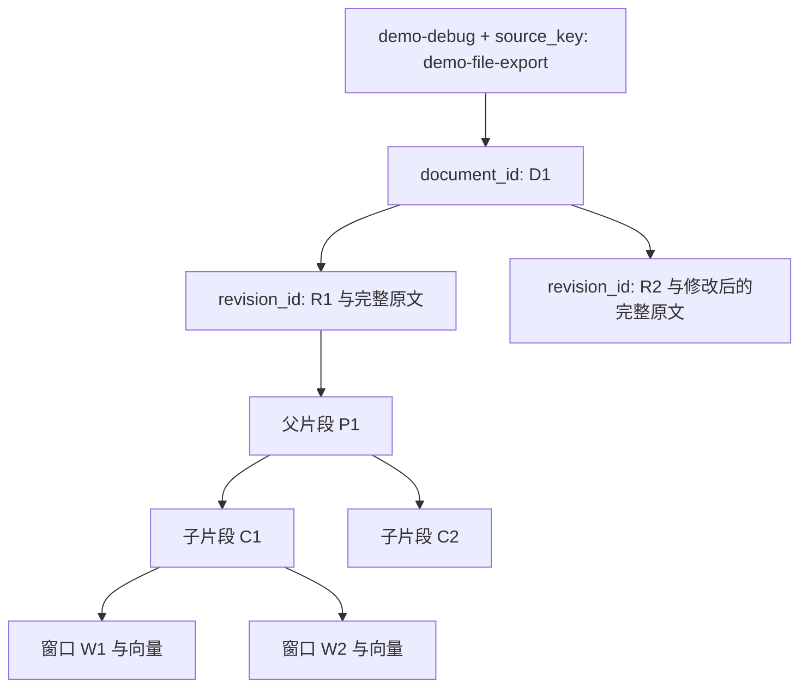

# 原文、向量与 BM25：从数据关系理解项目

日期：2026-11-01。配套：[远程 BGE-M3 接口要求](BGE-M3远程接口要求.md)。本文中的 D1、R1、C1、W1 为便于理解的别名，实际系统使用 UUID 等生成的 ID。

## 1. source_key 确实是一个 key

元数据是一组描述信息，包括标题、日期、业务快照、功能状态、来源标识等。source_key 是其中用来表示逻辑文档身份的字段，不是一个同时装着正文和向量的容器。

同一 source_key 可以对应多个修订版本，每个版本有多个片段，每个子片段又可能有多个向量窗口。因此不是 source_key 与一段文字、一条向量一对一。



业务快照、原文修订、索引代分别解决不同问题，不应都简写为一个“版本”。

## 2. 为什么当前使用 SQLite

当前是单人本机维护，原文量小，需要事务、关联查询和持久化，但不希望再运行一个关系数据库服务。SQLite 以文件保存数据，SQLAlchemy 提供表与事务访问，适合这一阶段。

选择它不是因为原文天然只能存 SQLite。以后可以迁移 PostgreSQL，或把大文件放对象存储、数据库保存文本与来源引用；需要结合实际规模、并发写入和部署要求决定。

目前 SQLite 负责“哪个库、哪份文档、哪版原文、哪些片段、当前发布哪一代”；Milvus负责“给定查询向量，找到哪些相关向量”。

## 3. 映射规则与存储位置

| 身份 | 生成与复用规则 | 保存位置 |
|---|---|---|
| source_key | 资料编写者指定；同一库内唯一，重命名文件时可保留 | documents.source_key 与文档元数据 |
| document_id | 首次遇到 kb_id/source_key 组合时生成，以后复用 | SQLite documents |
| revision_id | 原文、格式、有效元数据组成摘要；新内容生成新版本，相同内容复用 | SQLite document_revisions，保存完整 raw_text |
| chunk_id | 根据 revision、切片配置、片段顺序生成；配置变更会换身份 | SQLite source_chunks，保存 text、位置及父段 ID |
| 窗口 id | 根据 generation、chunk、窗口区间生成 | Milvus 主键与 lexical.json 的 windows |

一次向量命中可以按下面的关系回查：

```text
Milvus 命中 W1
→ 记录中的 chunk_id=C1、revision_id=R1
→ SQLite 查 C1 的原文片段与 R1
→ 查出文档、章节、行号、功能状态
```

SQLite 内部的部分关联使用外键；Milvus 与 SQLite 之间没有自动跨库 JOIN，回查与一致性验证由 Python 程序执行。

lexical.json 的 windows 额外保存窗口在子片段内的起止区间，用于核对窗口与原文的对应关系；Milvus 本身也保存 chunk/revision/generation 等关联字段。不是仅依赖文件名或向量返回顺序来猜测原文。

## 4. chunk 切分与分词是两个层次

| 操作 | 输入 | 输出 | 作用 |
|---|---|---|---|
| chunk 切分 | 完整文档 | 段落、步骤组等较大片段 | 决定检索和引用的文本单位 |
| BM25 分词 | 某个 chunk 的文字 | 词项列表 | 用于出现次数、区分度与长度统计 |
| 模型 tokenizer | 送给 Embedding/生成模型的文字 | 模型 token 与数值 ID | 满足模型的输入词表与推理接口 |

overlap、按标点、固定长度等可以用于 chunk 切分。当前 chunk 使用结构与长度上限，没有重叠；之后 BM25 还会在每个 chunk 内分词。

当前为了简单与可复现，连续中文按双字片段处理：

```text
文件导出 → 文件 / 件导 / 导出
```

这里看起来也有字符重叠，但发生在“词项表示”这一层，与让两个几百字 chunk 重叠不是同一件事。它是简化 baseline，不声称这些全部是语言学意义的完整中文词。

## 5. token 为什么能是中文，后面怎么处理

在 BM25 这里，token 指用于匹配和统计的词项，可以直接用中文字符串当作字典键：

```text
“文件”出现几次？
多少个片段包含“文件”？
查询里的“导出”是否出现在这个片段？
```

BM25 使用这些统计做算术评分，不需要把这些中文词项再交给 Embedding 模型。词项也可以编号成整数，不过 rank-bm25 接受字符串，我们当前就保留字符串。

模型 tokenizer 的数值 token ID 是另一个输入系统，不应与这里的字符串词项混成一个概念。

## 6. rank-bm25 是现成算法实现

这是提供 BM25 算法的 Python 库。库中的公式和执行流程是程序代码，语料统计、查询和最终排名则由本次数据决定。

为了便于阅读，下面直接使用几个分好的词示意，区别于项目实际的双字分词：

```python
from rank_bm25 import BM25Okapi

corpus = [
    ["导出", "取消", "临时文件"],
    ["相机", "预览"],
    ["悬浮层", "关闭"],
]
retriever = BM25Okapi(corpus)
scores = retriever.get_scores(["取消", "导出"])
```

构造对象时统计语料；搜索时根据 query 词项计算每个片段的分数，再排序选取候选。换语料或问题会改变结果；不是预先写死“这个问题必须返回那段话”。当前库文档明确把预处理/分词交给使用者：[rank-bm25](https://github.com/dorianbrown/rank_bm25)。

## 7. JSON 保存在哪里，什么时候给模型

默认路径：

```text
debug-rag/runtime/indexes/<generation_id>/lexical.json
```

当前发布代对应 `runtime/indexes/e3724e2f525b499d991eb5456d4266c5/lexical.json`。

文件中主要有：

- corpus：chunk_id 与 tokens 列表。
- windows：窗口 id、chunk_id、revision_id、窗口区间。
- generation_id 与 tokenizer 标识。

它由索引构建程序写出，由检索程序读取。保存成 JSON 是当前工程的序列化选择，便于检查与核对；以后也能存进数据库表。

**这个文件不会作为整份资料直接发送给 Agent 或生成模型。** 当前没有通用 Agent 执行器。实际发送给生成模型的是检索之后选出的原文证据、适用信息、用户问题和提示词。

```text
本地 JSON → Python 完成 BM25 与窗口映射核对
                      ↓
Milvus 命中 → SQLite 回查原文 → 证据选择 → 模型请求（如果允许外部调用）
```

网络请求也可能采用 JSON 协议，但“本地索引文件”和“模型 API 请求”是两份不同用途的数据。修改 config 不会自动增加解析 PDF、OCR 或读取任意格式的能力，程序仍需对应读取器。

## 8. 2026-11-01 新增 small-to-big

本次已在已有父子结构上实现：

1. 检索与 RRF 仍针对子片段。
2. 构建生成上下文时，从同一 generation 回查父片段。
3. 校验同 revision、同文档、同元数据、同章节以及原文包含关系。
4. 完整父片段放得进输入预算时使用父片段；同一父段只加入一次，记录触发它的子片段 ID。
5. 父段放不下则退回完整子片段；两者都放不下则跳过，不能随意截断后沿用完整引用。
6. E1 等证据 ID 与原文位置指向实际提供的父段或子段，原文查看接口支持这两种片段。

默认 `RAG_PARENT_EXPANSION_ENABLED=true`；设为 false 可做关闭对照。它不要求重建已有向量索引，因为父段已在 SQLite 保存。

免费检查入口：

```powershell
uv run --no-sync python -m debug_rag.cli context --kb demo-debug --question '相机状态展示接入时如何处理订阅与退出？'
```

也可以调用 `POST /api/v1/context`，或重启应用后点击“查看生成证据 · 本地”。这条路径需要已有本地索引和 Milvus 可连接，但不调用生成 API。

本次验证使用临时数据库与模拟依赖；真实模型问答和效果收益仍待验收。现有进程没有自动重载，代码变更需要重启应用才能在网页生效。

## 9. BGE-M3 的新决定

你已明确选择服务器或 API，不在笔记本运行 BGE-M3；目前没有远程服务，先准备契约。后续要确认真实模型、dense/sparse 输出、词表和版本、批处理关联、输入长度、错误与计费，再接适配器并重建独立索引。完整要求见 [BGE-M3 远程接口要求](BGE-M3远程接口要求.md)。
