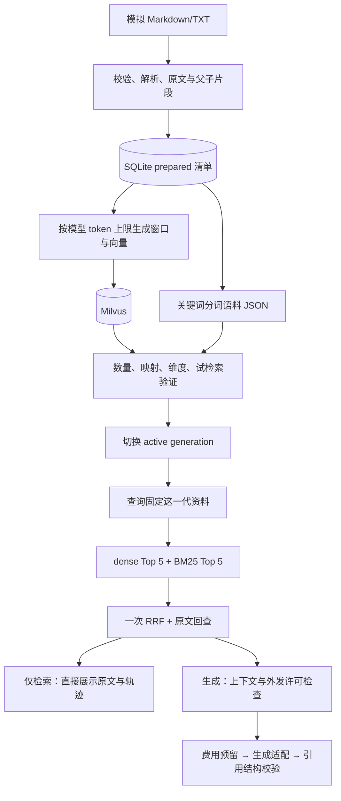

# Debug RAG：项目全景、完成情况与学习路线

核对日期：2026-11-01。本文按实际代码、SQLite 清单和已有测试记录编写，面向有 Android 开发经验、正在转向大模型应用开发的你。

新增基础篇：[原文、向量与 BM25 的数据关系](原文向量与BM25的数据关系.md)。small-to-big 已按用户要求接入，支持免费证据预览；BGE-M3 明确采用远程路线，尚未接通，见 [远程接口要求](BGE-M3远程接口要求.md)。

先读这份总览，再读 [P2 原理与代码导读](P2原理与代码导读.md)。第一次学习无需配置付费 API，也不要求一次读完全部代码。

## 1. 现在究竟做到哪一步

当前准确描述是：**P0、P1 已完成；P2 已有基础链路代码，真实本地索引构建发布已经验证，完整在线检索与真实生成验收尚未完成。**

这里有三个不同层次：

| 层次 | 当前证据 | 能说明什么 |
|---|---|---|
| 代码已实现 | 有检索、生成适配、费用控制、引用校验、API、页面代码 | 对应流程已经写出来 |
| 组件已验证 | 2026-10-26 有 74 项单元测试通过记录；本机真实 Milvus 索引构建成功 | 已覆盖一批软件行为，真实写入与构建试检索可用 |
| 完整场景已验收 | 四题 HTTP 检索报告尚未生成；未执行真实 DeepSeek 问答 | 这一层还不能宣布通过 |

“P2 的文件已经写好”不能直接等同于“P2 已验收完成”。也不建议把整个项目换算成一个没有依据的完成百分比。

### 1.1 在整个项目路线中的位置

| 阶段 | 目标 | 当前状态 | 还缺什么 |
|---|---|---|---|
| P0 工程与环境 | 独立环境、配置、SQLite、Milvus、诊断、模型冒烟 | 已完成，有历史验收记录 | 日常使用仍需启动进程和容器 |
| P1 资料与存储 | 模拟文档、元数据、解析、父子切片、版本保存 | 已完成 | 后续根据业务资料调整，不把模拟资料当公司事实 |
| P2 基础 RAG | dense + BM25 + RRF、生成适配、引用、最简页面 | 代码与索引构建已推进，完整验收未完成 | 本地 HTTP/浏览器闭环；真实生成另待你允许 |
| P3 需求闭环 | 多轮澄清、条件继承、会话隔离、更新删除与恢复流程 | 尚未完成 | 当前没有 session，也不能记住前一轮展示位置 |
| P4 进阶检索 | dense/sparse、重排、Query 改写与对照开关 | 部分代码已补齐 | 改写/独立重排及开关已有模拟 API 测试；BGE-M3 sparse 与真实质量对照未完成 |
| P5 评测与优化 | 固定测试集、对照报告、按失败案例优化 | 尚未完成 | 召回指标、答案支持性、多轮效果、性能与费用实验 |
| P6 业务资料接入 | 核对许可后的正式资料包与独立业务评测 | 尚未完成 | 资料搜集与边界核对需在公司完成 |

原方案把 P0–P3 作为第一份“整体框架可用”的交付；当前还没有走到那个完成点。P4 的进阶能力仍在计划中，并未因为先做 light 档位而取消。

### 1.2 当前真正保存了什么

本轮以只读方式核对 SQLite，得到：

- 演示库：`demo-debug`，业务快照 `demo-v1`，资料身份 `simulated`。
- 当前索引清单包含 8 份文档，33 个父片段、34 个子片段。
- 已发布索引 generation：`e3724e2f525b499d991eb5456d4266c5`。
- 对应 34 个向量窗口，512 维，本地 bge-small，CPU 编码。
- Milvus 集合名：`rag_light_e3724e2f525b499d991eb5456d4266c5`。
- SQLite 中还有 2 份 prepared 清单和 1 份 failed 构建记录；它们不是当前查询指针。
- 本项目 `api_calls` 表为 0 条。本轮没有执行付费调用。
- 当前没有 `runtime/P2-local-verification.json`，因此四题 HTTP 验收不能算通过。

这些 ID 是本机记录，换机器或重新构建会不同。SQLite 的 ready 记录说明曾经发布成功，不证明此刻 Docker、API 进程仍在运行，也不证明所有索引文件和容器数据永远不会丢失。

### 1.3 代码中有哪些能力，验证到了什么程度

| 能力 | 实现情况 | 当前验证边界 |
|---|---|---|
| Markdown/TXT 导入与严格元数据 | 已实现 | P1 实际导入及测试通过 |
| 原文定位、revision、幂等导入 | 已实现 | 有原文切片与历史版本核对记录 |
| 本地向量化、Milvus 写入及发布 | 已实现 | 实际构建、映射核对和向量自检索成功 |
| dense + BM25 + 一次 RRF | 已实现 | 有模拟组件测试；四题真实 HTTP 场景待完成 |
| 生成 API 请求适配 | 已实现 | MockTransport 验证，未发真实付费请求 |
| 结构化答案与引用 ID 校验 | 已实现 | 有伪造引用、格式错误等测试；语义支持性未完成评测 |
| 月预算预留与未知费用保留 | 已实现 | 临时数据库和模拟响应测试，不是供应商账单对账结果 |
| 最简页面及原文查看接口 | 已实现 | 部分页面观察与 API 模拟测试；完整真实浏览器流程待验收 |
| 多轮状态、Reranker、Query 改写 | 多轮未实现；改写/重排代码与模拟测试已补齐，默认关闭 | 不能把模拟 API 测试或提示词中的澄清要求当成真实模型效果或会话机制 |
| small-to-big | 已实现 | 已覆盖父段去重、预算回退、版本隔离和引用映射；真实问答收益待验证 |

## 2. 这个项目解决的到底是什么问题

你希望研发维护者或新接手同事，能够根据 Debug 功能资料，弄清楚前置条件、接入流程、生命周期、注意事项和验证方法。

例如：“文件导出取消后需要清理什么？”

普通搜索给出原文；RAG 在检索原文后，还会让模型基于这些材料组织回答，并给出能回到原文的引用。当前两个按钮正好区分这两条路径：

- **仅检索原文**：本地检索，返回候选和轨迹，不调用生成 API。
- **生成带引用的回答**：先检索，再经过资料外发许可、上下文预算、费用预留和模型输出校验。

本项目暂不操作设备、不执行 Android 调试动作、不直接检索公司源码，也不以真实日志分析作为当前功能。模拟资料中的开发步骤只是独立约定，不是已经开发完成的 Android 产品。

当前程序属于**显式编排的 RAG 应用**：执行顺序由 Python 代码决定。它没有让模型自主选择工具和反复规划任务，也没有使用 Agent 框架。后续 Agent 可以把这里的检索服务作为工具复用，但当前没有实现那个 Agent 项目。

## 3. 用到了哪些技术栈

下面的版本来自本机已安装包和项目锁定配置，不是“全网最新版本”推荐清单。

| 层 | 当前技术与记录 | 在这个项目中的工作 |
|---|---|---|
| 语言与环境 | Python 3.12；uv；`.venv`；`pyproject.toml`、`uv.lock` | 隔离依赖，复现安装与命令入口 |
| HTTP 服务 | FastAPI 0.162.0、Uvicorn 0.54.0 | 接收请求、校验输入、返回 JSON、提供网页 |
| 数据校验和配置 | Pydantic 2.14.1、pydantic-settings 2.16.1 | 元数据、请求/答案结构、环境变量与 SecretStr |
| 关系存储 | SQLite、SQLAlchemy 2.1.6 | 原文、文档身份、不可变版本、片段、索引清单、费用记录 |
| 文档解析 | markdown-it-py 4.2.0、PyYAML 6.0.3、Python JSON | Markdown 标题与块的行映射、元数据头、TXT sidecar |
| Embedding | BAAI/bge-small-zh-v1.5；Transformers 4.57.6；Torch 2.8.0+cpu | 把原文和查询编码成归一化的 512 维向量 |
| 向量检索 | Milvus 2.6.4、PyMilvus 2.6.2；FLAT + COSINE | 保存向量，按快照和功能状态过滤后搜索 |
| 关键词检索 | rank-bm25 0.2.2；自编中文双字片段/标识符 tokenizer | 补充字段名、术语等词面匹配 |
| 融合 | 普通 Python 实现 RRF | 根据各路排名合并证据，去除同路重复加分 |
| 生成适配 | HTTPX 0.28.1；DeepSeek `deepseek-flash` 适配代码 | 发送 JSON 请求、显式非思考模式、处理 usage 和错误；真实调用待验证 |
| 工程并发与费用 | filelock 3.32.7、SQLite 事务、Decimal/整数金额、tzdata | 同库构建互斥、预算原子预留、北京时间自然月统计 |
| 页面 | HTML、CSS、原生 JavaScript、fetch | 提问、展示候选与轨迹、查看引用位置 |
| 部署 | Docker Desktop、Docker Compose | 当前只运行 Milvus；Python 应用在 Windows 本机运行 |
| 测试 | pytest 9.1.1、HTTPX MockTransport、FastAPI TestClient、Ruff 0.17.2 | 验证数据与失败行为，检查静态代码和格式 |

### 3.1 必须分清“安装了”和“主链路调用了”

环境安装了 sentence-transformers 5.7.0，P0 模型冒烟使用过它。但 P2 的 `LocalEmbedder` 实际直接调用 `Transformers.AutoTokenizer` 和 `AutoModel`，取 CLS 向量再归一化。

因此你讲解当前 P2 时，应按代码说“Transformers + PyTorch 本地推理”，不能因为依赖清单存在某个包，就说整个检索流程都由那个包实现。

### 3.2 当前没有用到的技术

没有 LangChain、LangGraph、Elasticsearch、Redis、Kubernetes、React、Vue。qwen3-rerank 协议适配及可选链路已实现，真实服务未联调；BGE-M3、learned sparse、ColBERT、多模态 OCR 或伪文档生成仍未接入。当前也没有应用 Dockerfile 和整套应用容器化交付。最新增强链路见 [改写与独立重排说明](Query改写与独立重排接入说明.md)。

BM25 是算法；ES 是一种可以提供搜索能力的系统。这里已经能通过 Python 运行 BM25，不需要为了使用 BM25 再增加 ES。Docker 提供运行和打包环境，Milvus提供向量存储与检索，它们负责不同问题。

## 4. 先理解三条数据流



图中是已经存在的代码路径；其中真实生成请求没有执行。索引构建时模型读取文档，不意味着问答时把全部文档都发送到外部模型。

### 4.1 导入不是建索引

`ingest` 先让原文和片段进入 SQLite，并产生 prepared 清单。这个时候即使 Milvus没有启动，资料准备仍能成功。

### 4.2 建索引不是训练模型

`build-index` 用现成 bge-small 编码已有资料，写 Milvus并发布。没有梯度训练，没有改模型权重；这是推理和建立检索数据。

### 4.3 检索不是生成

`search` 只找材料。`ask` 或 `/api/v1/chat` 才进入生成适配器。前者的结果里有段落，不代表模型已经回答过问题。

## 5. 从你的 Android 经验迁移过来

| 你熟悉的概念 | 这里可以怎么理解 | 不要直接照搬的地方 |
|---|---|---|
| Kotlin data class / DTO | Pydantic 模型描述并校验输入输出 | Pydantic 还会在运行时拒绝非法值 |
| Retrofit / OkHttp 调用 | 页面 fetch、Python HTTPX 都在发 HTTP | FastAPI 本身是提供接口的服务端 |
| Room / SQLite | SQLAlchemy 管理 SQLite 表与事务 | `create_all()` 不会自动完成旧表改列迁移 |
| 应用启动与资源清理 | FastAPI lifespan 初始化数据库和组件，退出时清理 | 网页开着不代表后端进程还活着 |
| Repository / Service 分层 | storage 负责存取，retrieval/service 负责业务编排 | 不必为了套架构增加没有职责的薄层 |
| 构建产物、安装版本 | generation 固定一份索引使用的文档和配置 | generation 不是 Android app 版本，也不是模型版本 |
| 单元测试和真机验证 | FakeVectors/MockTransport 与真实 Milvus/API 验证分开 | 模拟接口通过不能冒充真实模型效果 |

你已经具备的价值在于理解生命周期、故障定位、状态一致性和用户流程。需要重点补的是 Python 数据处理、服务端 HTTP、检索原理、模型输入输出和评测证据。

## 6. 先具备哪些 Python 知识就够用

不必等学完一整本 Python 再开始。先能读懂这些语法：

- `list`、`dict`、列表/字典推导式：候选、元数据和响应都大量使用。
- 函数、类、类型提示、`@property`：组件接口和模型身份。
- `with`、上下文管理器、异常：文件、数据库事务、HTTP Client 生命周期。
- `Path`、UTF-8、JSON：资料路径与保存。
- `None`、集合 `set`、排序：可选配置、去重、排名。
- pytest 的 fixture、monkeypatch、断言：替换真实依赖进行失败测试。

首次遇到 `asynccontextmanager`，先理解“服务启动前准备资源，退出时释放资源”即可；不用先深入异步运行时。项目里的检索函数是普通同步函数。

## 7. 推荐的读代码顺序

不要按文件夹从上到下逐行背。每次带一个明确问题，记录“输入、输出、状态变化、失败行为”。

| 顺序 | 文件/函数 | 这一遍要回答的问题 |
|---|---|---|
| 1 | `fixtures/documents/01-demo-overview.md`、`05-file-export.md` | 系统的业务事实来自哪里？什么不能推断？ |
| 2 | `main.py` 的 `Question`、`search()`、`chat()` | 网页请求如何进入 Python？ |
| 3 | `components.py` 的 `components()` | 谁创建并共享模型、向量库、台账和服务对象？ |
| 4 | `retrieval/service.py` 的 `RagService.search()` | 一个问题如何经过两路检索与融合？ |
| 5 | `retrieval/lexical.py` | 中文和字段名怎么分词？RRF 怎么算？ |
| 6 | `retrieval/embedding.py`、`storage/milvus.py` | 文本怎么变向量？Milvus保存并返回什么？ |
| 7 | `ingestion/documents.py`、`chunking.py`、`service.py` | 原文和稳定 ID 从哪里产生？ |
| 8 | `retrieval/indexing.py`、`storage/sqlite.py` | 怎样让 SQLite、词面语料、Milvus属于同一个快照？ |
| 9 | `generation/grounding.py`、`provider.py`、`budget.py` | 什么证据能发出去？模型输出怎样变成可信结构？ |
| 10 | 对应测试、`web/index.html`、`scripts/start-local.ps1` | 怎么验证失败行为，怎样把页面恢复起来？ |

先读主路径，再回头读适配器细节。不要一开始就陷进模型权重文件和 SQLAlchemy 的所有 API。

## 8. 第一次学习，按这 45–60 分钟开始

下面是学习建议时段，不是要求你按固定速度完成。

### 第一步：用 10 分钟确认业务

读模拟总览和文件导出说明。用自己的话写下“用户是谁、输入是什么、输出是什么、资料不足时怎么办”。

### 第二步：用 10–15 分钟看已有资料，不启动外部服务

在 PowerShell 进入项目目录：

```powershell
Set-Location -LiteralPath 'C:\Users\15853\Documents\ChatGPT\Agent项目\debug-rag'
uv run --no-sync python -m debug_rag.cli inspect --kb demo-debug
uv run --no-sync python -m debug_rag.cli budget
```

`inspect` 默认读最后一次 prepared 清单，不是 active 查询指针，所以看到 P1 prepared 状态正常。想检查发布的那一代，可显式使用本机记录：

```powershell
uv run --no-sync python -m debug_rag.cli inspect --kb demo-debug --generation e3724e2f525b499d991eb5456d4266c5 --chunks
```

这些命令不用 Docker 或付费 API。若是全新环境，没有这些 ID，则先按 README 准备依赖和导入资料，不能照抄旧机器的 ID。

### 第三步：用 15–20 分钟沿请求走一遍

从 `main.py` 的 `/api/v1/search` 跳到 `RagService.search()`。把它整理成自己的 8–10 行流程；不要直接复制函数。重点找出固定 generation、查询模型身份检查、两路召回、去重和融合的位置。

### 第四步：用剩余时间手算一次 RRF

读下一份导读中的三候选例子，再对照 `fuse()`。你应该能解释“为什么两路都命中的候选可能排到单路第一名之前”，并知道这不是重排模型。

本次结束应留下两件产物：一张手画的数据流图和一份输入/输出笔记。是否做完自查题，不作为继续学习或开发的前置条件。

## 9. 分成六次学习，更容易吃透

| 次数 | 主题 | 动手做什么 | 完成标志 |
|---|---|---|---|
| 1 | 业务与主数据流 | 看资料、inspect、画图 | 能区分导入、建索引、检索、生成 |
| 2 | 原文与版本 | 用练习副本修改一篇文档再导入 | 能解释 document/revision/generation 为什么不同 |
| 3 | 检索原理 | 跑分词、手算 RRF、查看模拟测试 | 能解释 dense 和 BM25 的互补与局限 |
| 4 | 发布和故障 | 读失败构建、模型不匹配、损坏产物测试 | 能指出失败后为什么还可保留旧指针 |
| 5 | 生成与费用 | 运行 MockTransport 与引用测试 | 能区分语法合法、引用有效、事实被支持三件事 |
| 6 | 真实本地演示 | 手动启动服务、跑四题脚本、查看来源 | 形成自己实际执行的验收记录，而不是复制历史结论 |

### 练习 A：只看 tokenizer，完全离线

```powershell
uv run --no-sync python -c 'from debug_rag.retrieval.lexical import tokenize; print(tokenize("相机状态 camera_state"))'
```

预期包含：`相机`、`机状`、`状态`、`camera_state`。这里没有 jieba，中文采用连续双字片段。思考这种简化对同义表达和罕见字段名分别有什么影响。

### 练习 B：在独立练习库观察版本

使用项目内的临时练习目录；第一次复制前确认目标不存在：

```powershell
if (-not (Test-Path -LiteralPath runtime/learning-docs)) {
    Copy-Item -LiteralPath fixtures/documents -Destination runtime/learning-docs -Recurse
}
uv run --no-sync python -m debug_rag.cli ingest --kb learning-demo --source runtime/learning-docs
```

记录输出，再原样导入一次，观察新增 revision/chunk 应为 0。然后只编辑练习副本中的一句话，保留 source_key，再导入并对比 ID。不要修改标准演示资料来做破坏练习。

只执行 ingest 不会改变演示库 `demo-debug` 的已发布指针。当前 build-index 每次成功会建立新的索引 generation，尚未实现“重复 build 自动复用”；它与 P1 的幂等导入是两回事。

### 练习 C：用测试理解设计

```powershell
uv run --no-sync pytest tests/unit/test_retrieval.py -q
uv run --no-sync pytest tests/unit/test_grounding_and_api.py -q
uv run --no-sync pytest tests/unit/test_budget_and_provider.py -q
```

先读一个测试的名字和断言，再运行。看 FakeVectors、MockTransport 是如何替代真实系统的。若 Windows 权限使测试无法创建临时文件或事件循环，记录为环境阻塞；不能把它当作功能已通过。

### 练习 D：服务具备条件后，补真实本地验收

先手动打开 Docker Desktop，再运行：

```powershell
.\scripts\start-local.ps1
uv run --no-sync python scripts/verify_p2_local.py
```

四题脚本先检查模拟身份与外部调用关闭，然后检查检索、引用位置与跨库隔离。只有全部断言通过，才会写出 `runtime/P2-local-verification.json`。这是四个固定场景的冒烟验收，不是完整 Recall@K、正确率或生产压测报告。

本轮文档整理没有替你启动服务，也没有重新执行这份脚本。

## 10. 怎样判断自己真的理解了

完成这些任务比背技术名词更有用：

1. 不看代码画出“文件→片段→向量→检索→证据→回答”的流程，并标明各数据存在哪里。
2. 给定一个 chunk，能找到它对应的 revision、文档身份、章节和原文区间。
3. 给定两路排名，能手算一次 RRF，并说明与 cosine 和 rerank 的区别。
4. 能解释为什么旧网页还在，fetch 却可能失败。
5. 能在模拟测试中找到“索引失败不改旧指针”“超时不能当免费”“伪造引用不能展示”的证据。
6. 能在独立练习库改资料、重建并观察变化，说明哪些变化必须重建索引。
7. 能写出一个真实失败案例、可能原因、验证办法，而不是直接加一个新模型来碰运气。

建议每次学习保留一页笔记：`本次问题 / 输入输出 / 关键函数 / 实际观察 / 还不确定什么`。之后我们可以按模块讲解，你遇到不懂的语法或数据结构时直接用这份笔记定位。

## 11. 当前应如何对外描述这个项目

可以描述自己正在构建一个基于独立模拟研发资料的 RAG 原型，已经实现资料版本管理、原文定位、本地向量与关键词检索融合，以及生成接口和引用校验代码。真实索引构建有记录，已有单元测试覆盖。

尚不能说：公司已经使用、提升了多少效率、真实业务准确率是多少、已经完成 Agent、多轮问答已跑通、BGE-M3/重排/OCR 已上线。74 个测试通过也不等于 74 道真实问答正确。

下一步先补齐 P2 本地端到端验收；真实生成继续遵守你暂不付费验证的选择。之后再完成 P3 的多轮与资料更新闭环，最后做可解释的进阶实验和评测。

## 12. 阅读资料的优先级

先用本仓库的实现作为学习对象，官方资料只补当前正在看的概念：

- [P2 原理与代码导读](P2原理与代码导读.md)：按一条请求逐层解释。
- [P1 学习与验收](P1学习与验收.md)：文件、原文、版本与父子切片。
- [P0 学习与验收](P0学习与验收.md)：环境、服务与健康检查；其中运行状态是当时记录。
- [FastAPI 官方教程](https://fastapi.tiangolo.com/tutorial/)：先看请求体、校验、错误处理与生命周期相关章节。
- [SQLAlchemy 事务教程](https://docs.sqlalchemy.org/en/20/tutorial/dbapi_transactions.html)：理解提交、回滚和连接；本机安装为 2.1.6，具体 API 仍以当前代码为准。
- [Milvus 2.6 度量文档](https://milvus.io/docs/v2.6.x/metric.md)：理解 COSINE、IP、稀疏检索概念的区别。
- [rank-bm25 项目文档](https://github.com/dorianbrown/rank_bm25)：理解它接收预分词语料，以及本项目自己承担的分词工作。
